# McpNet

<p align="center"></p>

> Windows 桌面網路分析與協定除錯工具，整合封包檢視、規則處理、插件擴充與本機 MCP 服務。

**繁體中文（預設）** · [简体中文](#简体中文) · [English](#english)

| 最新穩定版 | 平台 | 直接下載 | 全部版本 |
|---|---|---|---|
| **v1.1.0** · 第二版（修復全屏設定視窗邊界、補充功能截圖） | Windows x64 | [下載 McpNet-v1.1.0-windows-x64.exe](https://github.com/infycat/McpNet/releases/download/v1.1.0/McpNet-v1.1.0-windows-x64.exe) | [全部版本](https://github.com/infycat/McpNet/releases) |

[v1.1.0 更新內容與 SHA-256](https://github.com/infycat/McpNet/releases/tag/v1.1.0)

下載成品請使用上表的 EXE 連結；GitHub 頁面上的 **Source code ZIP/TAR.GZ 是原始碼，不是安裝程式**。首次使用前請查看下方的系統需求及安全提醒。

## 專案簡介

McpNet 由 Go/Wails 桌面後端、Vue 3 介面與 McpNet 網路核心組成。它可檢視和處理 HTTP(S)、WebSocket、TCP、UDP 流量，並提供規則、腳本、使用者插件及本機 MCP 整合。程式啟動不會自動開始全系統攔截：流量監聽與系統代理由使用者分別控制。

### 品牌圖示

新版採用方形透明底圖示，將「Net」字樣直接融入封包路徑與 MCP 連接節點；青綠漸層為主色，搭配白色連接點、黃色訊號段與深色描邊，讓網路抓包與 MCP 元素更清晰易辨。`build/appicon.png` 是預覽來源，Windows/Wails 使用的 `.ico` 資源同步更新為同一設計。

| 類別 | 功能 |
|---|---|
| 流量分析 | HTTP/HTTPS 請求與回應、WebSocket 訊息、TCP/UDP 連線與資料檢視 |
| 規則與處理 | Hosts、轉送／替換、請求與回應處理、憑證及腳本設定 |
| 擴充能力 | Yaegi Go 插件、腳本範本、協定內容處理 hook |
| MCP 整合 | 本機 HTTP MCP、狀態查詢、監聽控制、系統代理及 UI 命令工具 |
| 桌面介面 | Windows、Wails v2、Vue 3、WebView2；繁體中文、簡體中文與英文 |

## 架構與資料流程

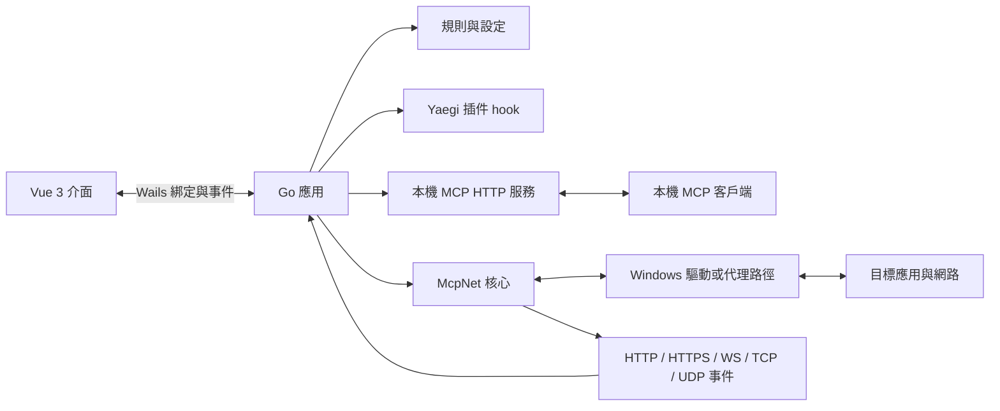

### 封包處理流程

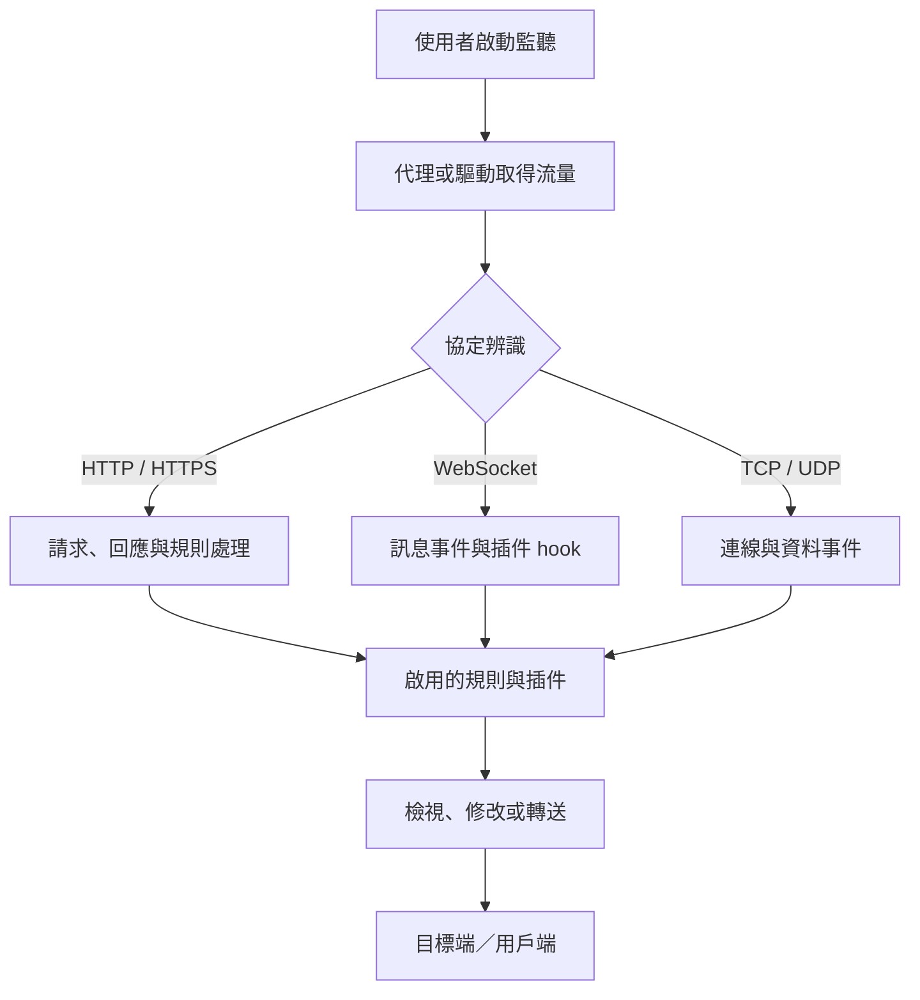

### 功能截圖

以下產品截圖用來直觀展示主要功能：進程攔截與附近應用清單、程式設定、多色系主題、本機 Go 插件編輯，以及 MCP 服務設定。

**進程攔截與附近應用清單**

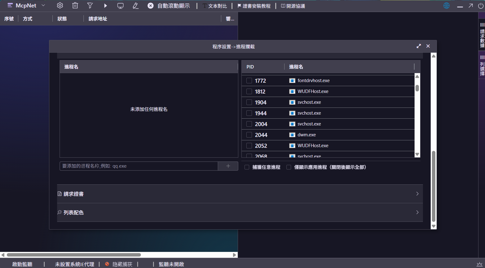

**程式設定與語言選擇**

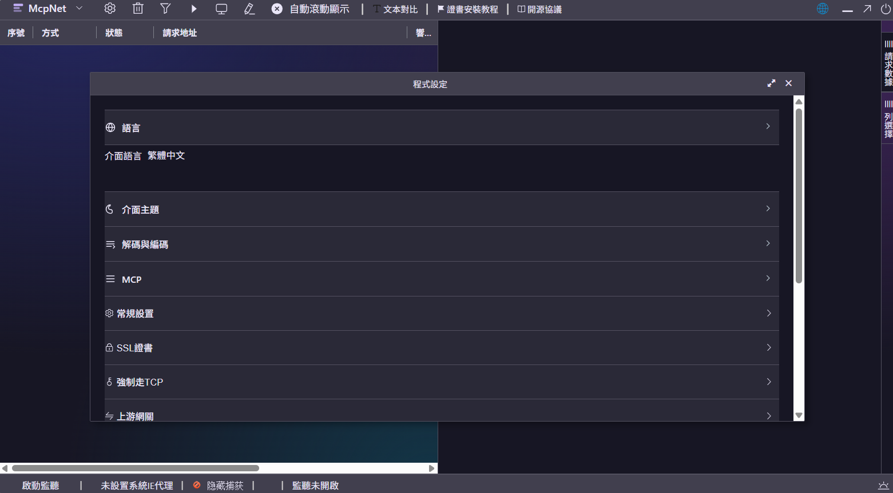

**多色系主題**

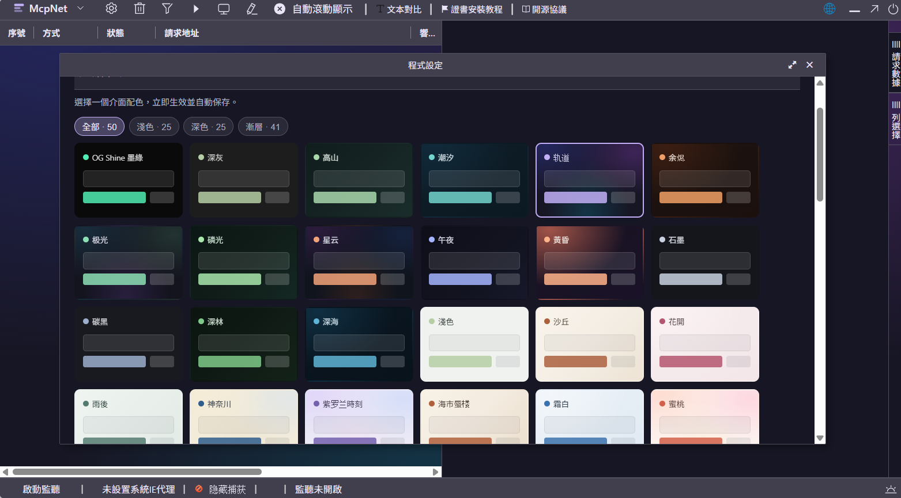

**本機 Go 插件編輯器**

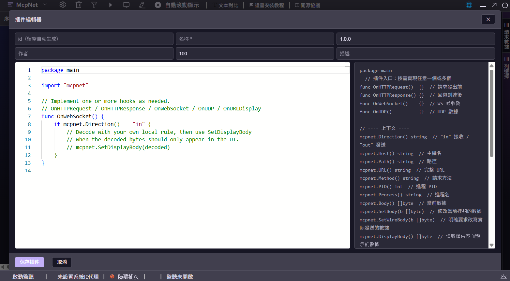

**本機 MCP 服務設定**

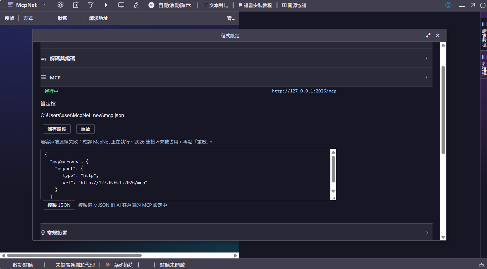

### 腦圖

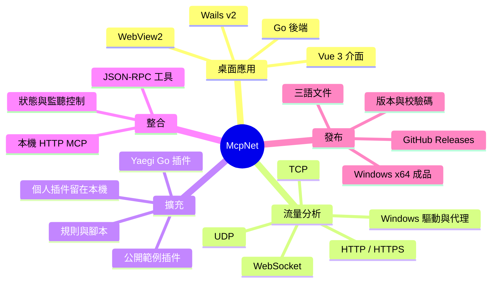

### 專案分佈與發布

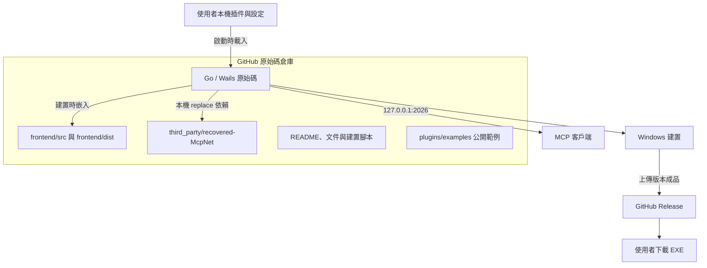

## 支援協定與 MCP

| 協定／介面 | 支援功能 | 條件與限制 |
|---|---|---|
| HTTP | 請求／回應檢視、規則處理、插件 hook、內容編輯 | 流量須經過已啟用的監聽路徑 |
| HTTPS / TLS | TLS/HTTPS 處理、憑證管理 | 解密取決於 CA 信任、憑證釘選及應用程式行為 |
| WebSocket | 連線與訊息檢視、訊息 hook、編解碼處理 | 取決於代理路徑及啟用的規則／插件 |
| TCP | 連線與資料事件、轉送及腳本處理 | 取決於 Windows 驅動或代理設定 |
| UDP | 收送事件與插件 hook | 擷取可能需要驅動、程序設定或代理 |
| MCP | JSON-RPC、工具呼叫、SSE、健康檢查 | 預設僅綁定 `127.0.0.1:2026` |

MCP 端點：`http://127.0.0.1:2026/mcp`；健康檢查：`http://127.0.0.1:2026/health`。支援 `initialize`、`ping`、`tools/list`、`tools/call`，並提供狀態查詢、監聽啟停、系統代理、UI 命令及說明工具。`mcpnet_list_captures` 可列出捕獲會話，`mcpnet_get_capture` 與 `mcpnet_get_messages` 可讀取詳情和訊息；URL 查詢值、使用者資訊與片段會遮蔽。封包標頭與本文預設不回傳，需明確傳 `include_body=true`（本文 Base64，每段最多 64 KiB）。查詢不會自行開啟監聽；本機其他程式也可能連線至 loopback MCP。

## 版本與下載

目前正式下載版本為 v1.1.0；v1.0.0 保留為首版。GitHub 自動產生的原始碼壓縮檔不是可執行成品。

| 版本 | 日期 | 狀態 | 平台 | 成品下載 | 發布資訊 |
|---|---|---|---|---|---|
| **v1.1.0** | 2026-10-20 | 第二版；調整全屏設定視窗上下邊界、補充功能截圖 | Windows x64 | [McpNet-v1.1.0-windows-x64.exe](https://github.com/infycat/McpNet/releases/download/v1.1.0/McpNet-v1.1.0-windows-x64.exe) | [更新說明與 SHA-256](https://github.com/infycat/McpNet/releases/tag/v1.1.0) |
| **v1.0.0** | 2026-10-20 | 首個正式版本；主題底板、全屏設定視窗、圖示與作者頁更新 | Windows x64 | [McpNet-v1.0.0-windows-x64.exe](https://github.com/infycat/McpNet/releases/download/v1.0.0/McpNet-v1.0.0-windows-x64.exe) | [更新說明與 SHA-256](https://github.com/infycat/McpNet/releases/tag/v1.0.0) |

本版修正程式設定最大化時頂部覆蓋主視窗工具列、右上控制按鈕重疊、底部未延伸至視窗邊緣而露出主介面及捲軸的問題；並整理 README 功能截圖，使其出現在腦圖之前。首版 v1.0.0 的主題與品牌更新詳見其 Release。

v1.1.0 成品大小：91,961,856 bytes；SHA-256：`6939D6EB999FE8869E0C89B987FE22C5EBC01446874429746B8D03F57F2E93CD`。v1.0.0 SHA-256：`BFC3825775BCE65E29169A6DE613294BB3D5B987B12E7425EDD83FF1218C7630`。

## 安裝與使用

- **平台：** Windows x64。需要 WebView2 Runtime；部分流量攔截情境也需要相應驅動、憑證或系統設定。
- **啟動：** 下載 EXE 後執行。若 Windows 顯示 UAC，請依自己的環境判斷是否授權。
- **監聽：** 開啟程式不等於開始全系統抓包；在介面中自行啟動監聽，並按需要分別設定系統代理。
- **HTTPS：** 解密可能需要安裝並信任本機 CA；憑證釘選等應用程式保護可能阻止解密。
- **資料位置：** 設定、WebView2 資料及插件位於 `%USERPROFILE%\McpNet_new\`。

只在你有權分析的裝置及流量上使用本工具。修改系統代理或安裝 CA 會影響本機網路行為，使用前請理解其影響。

## 插件與公開內容邊界

執行時從 `%USERPROFILE%\McpNet_new\plugins\<plugin-id>\` 載入使用者插件（包含 `plugin.json` 和 `main.go`）。插件 hook 可處理 HTTP、WebSocket、UDP 事件及 UI 顯示資料；具有修改封包本文的能力，只安裝你信任的插件。

你的個人協定插件留在本機使用者資料目錄；GitHub 僅公開通用範例 `plugins/examples/`，不包含個人插件、協定金鑰、使用者設定、抓包資料或建置後的 EXE。公開版使用者不會取得本機個人插件。

## 從原始碼建置

需求：Windows、Go 1.23+、Node.js/npm、WebView2 Runtime。重新產生 Windows 資源時另需 MinGW `windres`。前端 `dist/` 與 `app.syso` 是 Go 建置輸入，請保留。

```powershell
npm --prefix frontend ci
npm --prefix frontend run build
powershell -ExecutionPolicy Bypass -File .\scripts\build.ps1
```

建置成品 `McpNet.exe` 不加入 Git；個人插件也由 `.gitignore` 排除。倉庫根目錄是本專案的 `deliverable/source/`，請勿改用上層工作區目錄作為發布根目錄。

## 目錄導覽

```text
.
├─ main.go, app.go, mcp.go, Config.go     Go / Wails 應用程式
├─ CommAnd/                               UI 命令與事件分派
├─ MapHash/                               請求／連線輔助
├─ Resource/                              內嵌腳本範本與資源
├─ frontend/src/                          Vue 前端原始碼
├─ frontend/dist/                         Go embed 使用的前端成品
├─ third_party/recovered-McpNet/          go.mod 本機 replace 核心
├─ build/                                 Windows 圖示與資源
├─ scripts/                               建置與維護腳本
├─ docs/                                  延伸技術文件
└─ plugins/examples/                      可公開的安全範例
```

## 授權與第三方元件

本專案採 MIT License。核心與前端包含第三方元件，仍適用其各自授權與版權聲明；發布或再散佈時請保留倉庫中的授權文件。

---

## 简体中文

[繁體中文](#mcpnet) · **简体中文（默认）** · [English](#english)

| 最新稳定版 | 平台 | 直接下载 | 全部版本 |
|---|---|---|---|
| **v1.1.0** · 第二版（修复全屏设置窗口边界、补充功能截图） | Windows x64 | [下载 McpNet-v1.1.0-windows-x64.exe](https://github.com/infycat/McpNet/releases/download/v1.1.0/McpNet-v1.1.0-windows-x64.exe) | [全部版本](https://github.com/infycat/McpNet/releases) |

[v1.1.0 更新内容与 SHA-256](https://github.com/infycat/McpNet/releases/tag/v1.1.0)

McpNet 是 Windows 桌面网络分析与协议调试工具，由 Go/Wails 后端、Vue 3 界面和 McpNet 核心组成。它支持 HTTP(S)、WebSocket、TCP、UDP 流量查看与规则处理，并提供脚本、用户插件和本机 MCP。启动应用不会自动开启全系统流量拦截；监听与系统代理由用户分别控制。

### 品牌图标

新版采用方形透明底图标，将“Net”字样直接融入数据包路径与 MCP 连接节点；以青绿渐变为主色，搭配白色连接点、黄色信号段和深色描边，让网络抓包与 MCP 元素更清晰易辨。`build/appicon.png` 是预览源图，Windows/Wails 使用的 `.ico` 资源同步更新为同一设计。

| 类别 | 功能 |
|---|---|
| 流量分析 | HTTP/HTTPS 请求与响应、WebSocket 消息、TCP/UDP 连接与数据 |
| 规则处理 | Hosts、转发／替换、请求和响应处理、证书及脚本设置 |
| 扩展 | Yaegi Go 插件、脚本模板、协议内容处理 hook |
| MCP | 本机 HTTP MCP、状态查询、监听控制、系统代理及 UI 命令 |
| 桌面端 | Windows、Wails v2、Vue 3、WebView2；繁中、简中和英文 |

### 架构与流程

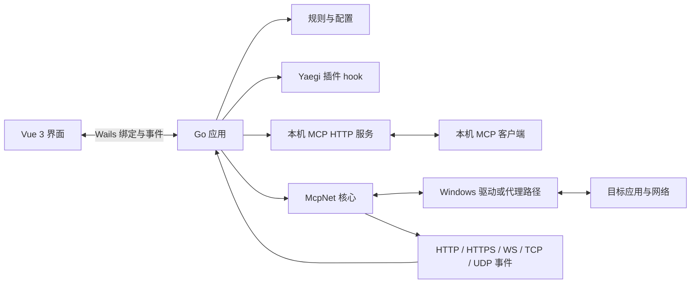

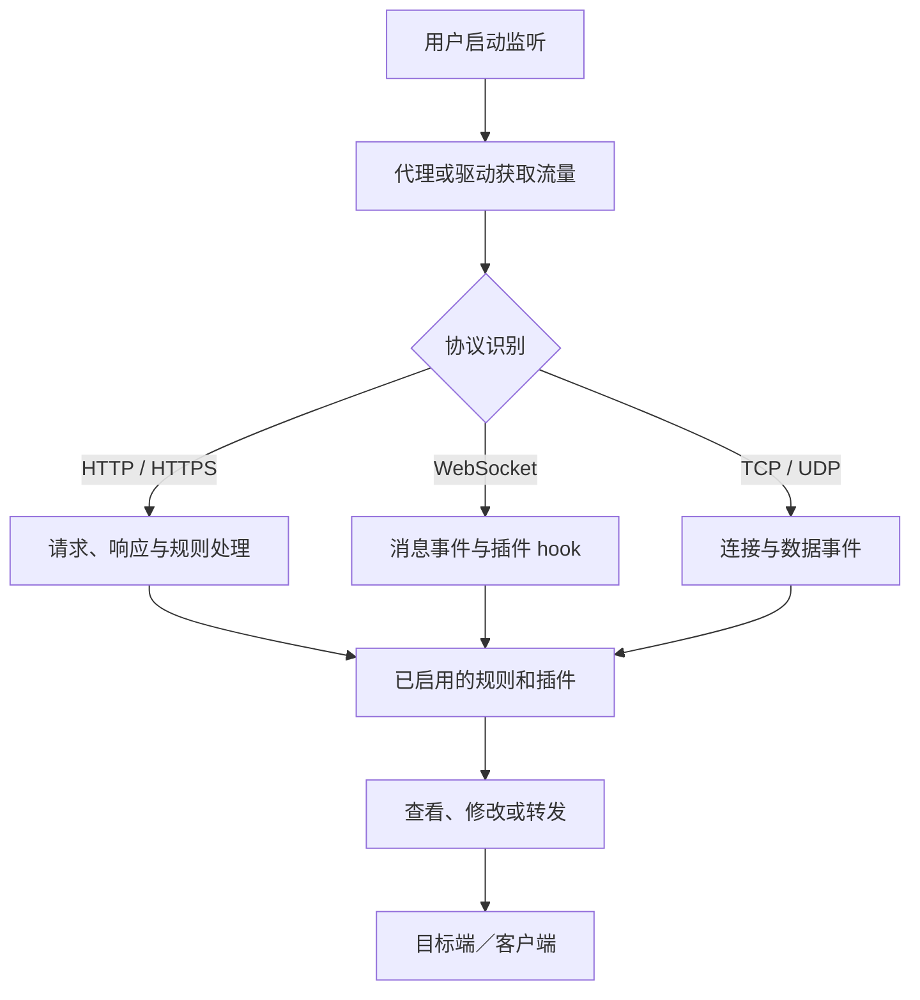

### 功能截图

以下产品截图直观展示主要功能：进程拦截与附近应用列表、程序设置、多色系主题、本地 Go 插件编辑和 MCP 服务设置。

**进程拦截与附近应用列表**


**程序设置与语言选择**


**多色系主题**


**本地 Go 插件编辑器**


**本机 MCP 服务设置**


### 思维导图

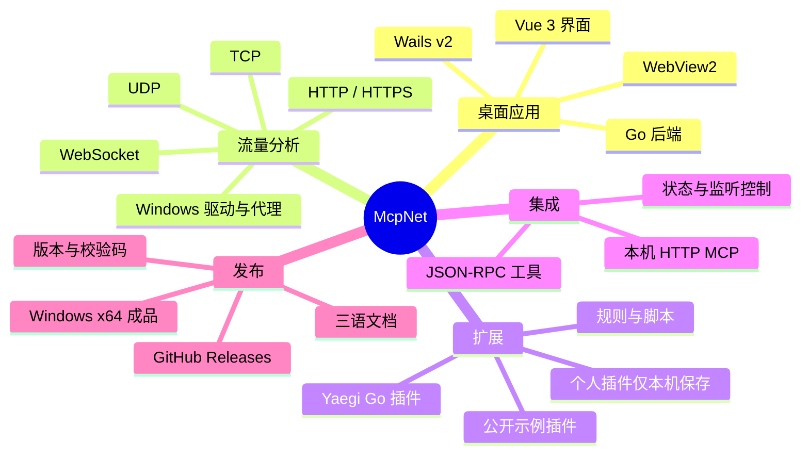

### 协议与使用条件

| 协议／接口 | 能力 | 条件与限制 |
|---|---|---|
| HTTP | 请求／响应查看、规则、插件 hook、内容编辑 | 流量须通过已启用的监听路径 |
| HTTPS / TLS | TLS/HTTPS 处理、证书管理 | 解密受 CA 信任、证书固定及应用行为影响 |
| WebSocket | 连接与消息查看、消息 hook、编解码处理 | 取决于代理路径及已启用规则／插件 |
| TCP | 连接与数据事件、转发和脚本处理 | 取决于 Windows 驱动或代理设置 |
| UDP | 收发事件和插件 hook | 捕获可能需要驱动、进程配置或代理 |
| MCP | JSON-RPC、工具调用、SSE、健康检查 | 默认仅绑定 `127.0.0.1:2026` |

MCP 地址为 `http://127.0.0.1:2026/mcp`，健康检查为 `/health`。`mcpnet_list_captures`、`mcpnet_get_capture` 和 `mcpnet_get_messages` 可查询捕获会话与消息；URL 查询参数值、用户信息和片段会自动遮蔽。请求头和数据体默认不返回；显式设置 `include_body=true` 后才返回（Base64，每段最多 64 KiB）。查询不会自动启动监听。系统代理工具可能同时启动监听，本机其他程序也可能连接本地 MCP 服务。

### 版本与下载

| 版本 | 日期 | 状态 | 平台 | 成品下载 | 发布信息 |
|---|---|---|---|---|---|
| **v1.1.0** | 2026-10-20 | 第二版；调整全屏设置窗口边界、补充功能截图 | Windows x64 | [下载 EXE](https://github.com/infycat/McpNet/releases/download/v1.1.0/McpNet-v1.1.0-windows-x64.exe) | [更新说明与校验码](https://github.com/infycat/McpNet/releases/tag/v1.1.0) |
| **v1.0.0** | 2026-10-20 | 首个正式版本；修复主题底板与全屏设置窗口、更新图标与作者页 | Windows x64 | [下载 EXE](https://github.com/infycat/McpNet/releases/download/v1.0.0/McpNet-v1.0.0-windows-x64.exe) | [更新说明与校验码](https://github.com/infycat/McpNet/releases/tag/v1.0.0) |

当前正式下载版本为 v1.1.0，v1.0.0 保留为首版。本版修复程序设置最大化时覆盖主窗口工具栏、右上角控制按钮重叠，以及底部未延伸至窗口边缘而露出主界面和滚动条的问题；并将功能截图放在脑图之前。GitHub 自动生成的 Source code 压缩包是源码，不是应用程序。

v1.1.0 文件大小：91,961,856 bytes；SHA-256：`6939D6EB999FE8869E0C89B987FE22C5EBC01446874429746B8D03F57F2E93CD`。v1.0.0 SHA-256：`BFC3825775BCE65E29169A6DE613294BB3D5B987B12E7425EDD83FF1218C7630`。

### 安装、插件与安全

- Windows x64；需要 WebView2 Runtime，部分捕获场景也需要驱动、证书或系统设置。
- 启动应用不会自动开启全系统抓包；请在界面中自行启动监听，并按需单独设置系统代理。
- HTTPS 解密可能需要安装并信任本机 CA；证书固定等机制可能阻止解密。仅分析你有权检查的设备与流量。
- 配置、WebView2 数据和用户插件位于 `%USERPROFILE%\McpNet_new\`。插件从 `plugins\<plugin-id>\` 加载，能处理甚至修改流量，只安装可信代码。
- 个人协议插件只保留在本机；GitHub 仓库仅包含 `plugins/examples/` 的通用示例，不发布个人插件、密钥、抓包或 EXE。

### 源码构建与目录

需要 Windows、Go 1.23+、Node.js/npm 和 WebView2 Runtime。`frontend/dist/` 与 `app.syso` 是构建输入。

```powershell
npm --prefix frontend ci
npm --prefix frontend run build
powershell -ExecutionPolicy Bypass -File .\scripts\build.ps1
```

主要目录：`CommAnd/`（UI 命令）、`MapHash/`（请求辅助）、`Resource/`（脚本资源）、`frontend/src/`（Vue 源码）、`frontend/dist/`（嵌入前端）、`third_party/recovered-McpNet/`（本地核心依赖）、`build/`（Windows 资源）、`scripts/`（构建脚本）、`docs/`（扩展文档）、`plugins/examples/`（公开示例）。此仓库以 `deliverable/source/` 为根目录。本项目采用 MIT License；第三方组件仍适用各自许可，重新发布时请保留其许可声明。

---

## English

[繁體中文](#mcpnet) · [简体中文](#简体中文) · **English (default)**

| Latest stable | Platform | Direct download | All versions |
|---|---|---|---|
| **v1.1.0** · Second release (maximized settings bounds fixed; feature screenshots added) | Windows x64 | [Download McpNet-v1.1.0-windows-x64.exe](https://github.com/infycat/McpNet/releases/download/v1.1.0/McpNet-v1.1.0-windows-x64.exe) | [All releases](https://github.com/infycat/McpNet/releases) |

[v1.1.0 notes and SHA-256](https://github.com/infycat/McpNet/releases/tag/v1.1.0)

McpNet is a Windows desktop network analysis and protocol debugging tool built with a Go/Wails backend, Vue 3 UI, and the McpNet core. It inspects and processes HTTP(S), WebSocket, TCP, and UDP traffic, with rules, scripts, user plugins, and a local MCP service. Launching the app does **not** enable system-wide interception; capture and system-proxy controls are separate.

### App icon

The refreshed square icon uses a transparent background and integrates the “Net” lettering with packet paths and MCP connection nodes. A cyan-to-mint gradient, white connector rings, yellow signal accents, and a dark outline make both network capture and MCP immediately recognizable. `build/appicon.png` is the preview source; the Windows/Wails `.ico` resources use the same artwork.

| Area | Capabilities |
|---|---|
| Traffic analysis | HTTP/HTTPS requests and responses, WebSocket messages, TCP/UDP connections and payloads |
| Rules | Hosts, forwarding/replacement, request/response processing, certificates, and scripts |
| Extensions | Yaegi Go plugins, script templates, protocol-processing hooks |
| MCP | Local HTTP MCP, status, capture controls, system proxy, and UI-command tools |
| Desktop | Windows, Wails v2, Vue 3, WebView2; Traditional Chinese, Simplified Chinese, and English |

### Architecture and flow

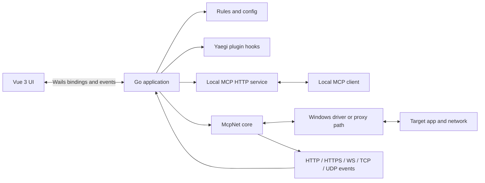

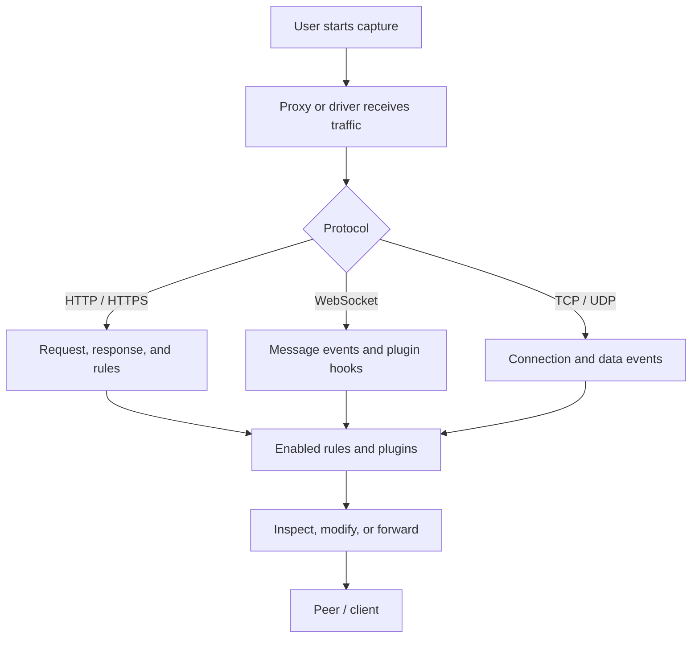

### Feature screenshots

These product screenshots demonstrate the main features: process interception and nearby-process discovery, application settings, the multi-color theme gallery, local Go plugin editing, and MCP service configuration.

**Process interception and nearby-process list**


**Application settings and language selection**


**Multi-color themes**


**Local Go plugin editor**


**Local MCP service settings**


### Mind map

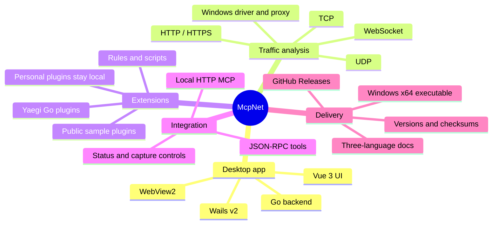

### Protocols and conditions

| Protocol / interface | Capability | Conditions and limitations |
|---|---|---|
| HTTP | Request/response inspection, rules, hooks, body editing | Traffic must traverse an enabled capture path |
| HTTPS / TLS | TLS/HTTPS handling and certificate management | Decryption depends on CA trust, pinning, and app behavior |
| WebSocket | Connection/message inspection, hooks, codec processing | Depends on proxy path and enabled rules/plugins |
| TCP | Connection/data events, forwarding, and scripts | Depends on Windows driver or proxy configuration |
| UDP | Send/receive events and plugin hooks | Capture may require a driver, process setup, or proxy |
| MCP | JSON-RPC, tools, SSE, health check | Bound to `127.0.0.1:2026` by default |

MCP endpoints: `http://127.0.0.1:2026/mcp` and `/health`. `mcpnet_list_captures`, `mcpnet_get_capture`, and `mcpnet_get_messages` expose captured sessions and messages; URL query values, user info, and fragments are redacted. Headers and bodies are omitted by default; set `include_body=true` to request Base64 payloads (64 KiB per body). Queries do not start capture. Proxy control may start capture. Other local processes can connect to the loopback service.

### Versions and downloads

| Version | Date | Status | Platform | Download | Release info |
|---|---|---|---|---|---|
| **v1.1.0** | 2026-10-20 | Second release; maximized settings bounds fixed and feature screenshots added | Windows x64 | [Download EXE](https://github.com/infycat/McpNet/releases/download/v1.1.0/McpNet-v1.1.0-windows-x64.exe) | [Notes and checksum](https://github.com/infycat/McpNet/releases/tag/v1.1.0) |
| **v1.0.0** | 2026-10-20 | Initial stable release; themed panels, maximized settings, icon, and author page updated | Windows x64 | [Download EXE](https://github.com/infycat/McpNet/releases/download/v1.0.0/McpNet-v1.0.0-windows-x64.exe) | [Notes and checksum](https://github.com/infycat/McpNet/releases/tag/v1.0.0) |

The current official download is v1.1.0, with v1.0.0 retained as the initial release. This version fixes maximized settings covering the main toolbar, overlapping the top-right window controls, and leaving underlying content or scrollbars visible at the bottom. Feature screenshots are also placed before the README mind maps. GitHub's automatically generated source archives are not executable builds.

v1.1.0 file size: 91,961,856 bytes; SHA-256: `6939D6EB999FE8869E0C89B987FE22C5EBC01446874429746B8D03F57F2E93CD`. v1.0.0 SHA-256: `BFC3825775BCE65E29169A6DE613294BB3D5B987B12E7425EDD83FF1218C7630`.

### Setup, plugins, and safety

- Windows x64; WebView2 Runtime is required. Some capture scenarios also need drivers, certificates, or OS configuration.
- Launching the app does not enable system-wide capture. Start capture in the UI and configure the system proxy separately as needed.
- HTTPS decryption may require trusting a local CA; certificate pinning may prevent decryption. Use only with devices and traffic you are authorized to inspect.
- User settings, WebView2 data, and plugins live under `%USERPROFILE%\McpNet_new\`. Plugins load from `plugins\<plugin-id>\` and may modify traffic; install only trusted code.
- Personal protocol plugins remain on the developer's machine. The GitHub repository contains only generic `plugins/examples/`; personal plugins, keys, captures, and the built EXE are not committed.

### Build from source and layout

Requirements: Windows, Go 1.23+, Node.js/npm, and WebView2 Runtime. `frontend/dist/` and `app.syso` are build inputs.

```powershell
npm --prefix frontend ci
npm --prefix frontend run build
powershell -ExecutionPolicy Bypass -File .\scripts\build.ps1
```

Key paths: `CommAnd/` (UI commands), `MapHash/` (request helpers), `Resource/` (script resources), `frontend/src/` (Vue source), `frontend/dist/` (embedded frontend), `third_party/recovered-McpNet/` (local core dependency), `build/` (Windows resources), `scripts/` (build scripts), `docs/` (extended docs), and `plugins/examples/` (public samples). The repository root is `deliverable/source/`. This project uses the MIT License; third-party components retain their own license terms, which must be preserved when redistributing.
