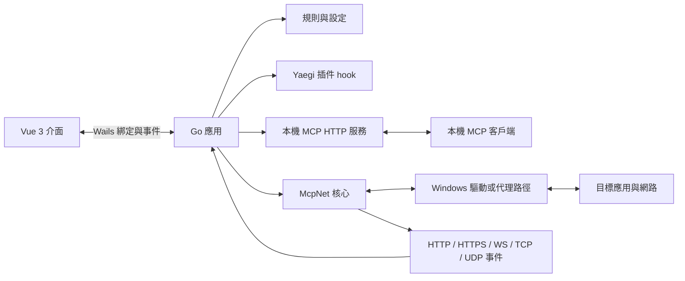
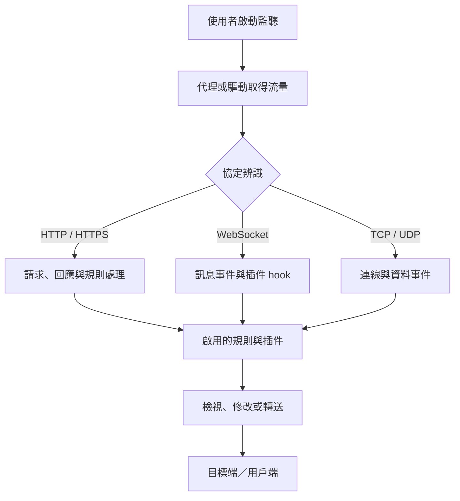
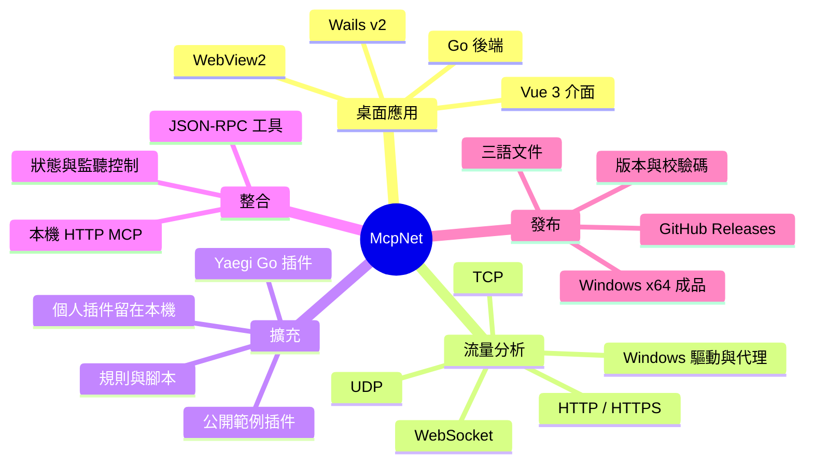
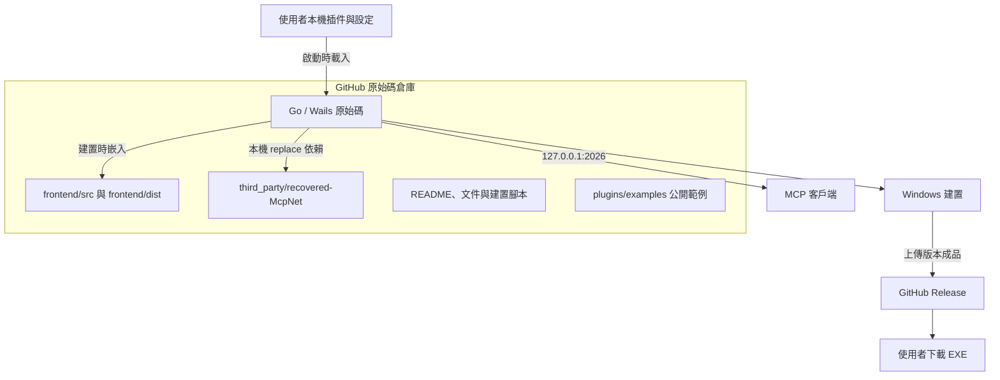
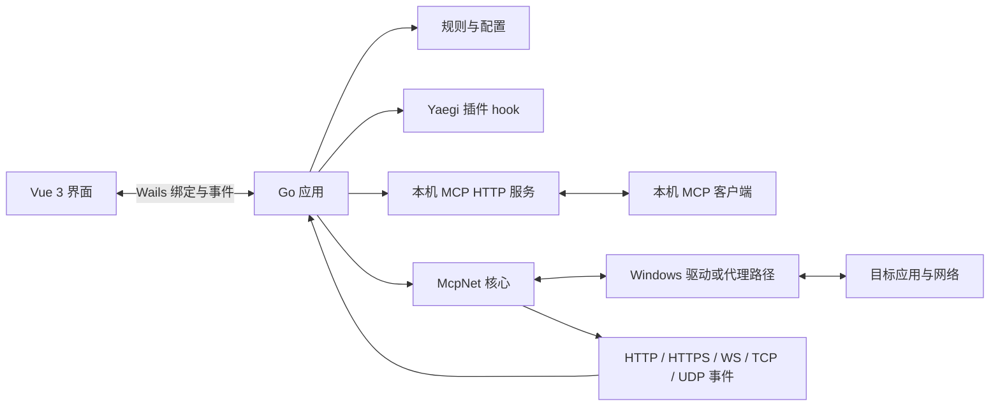
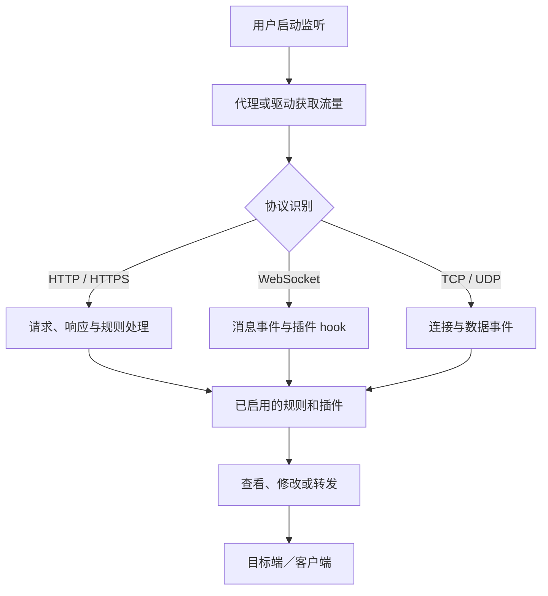
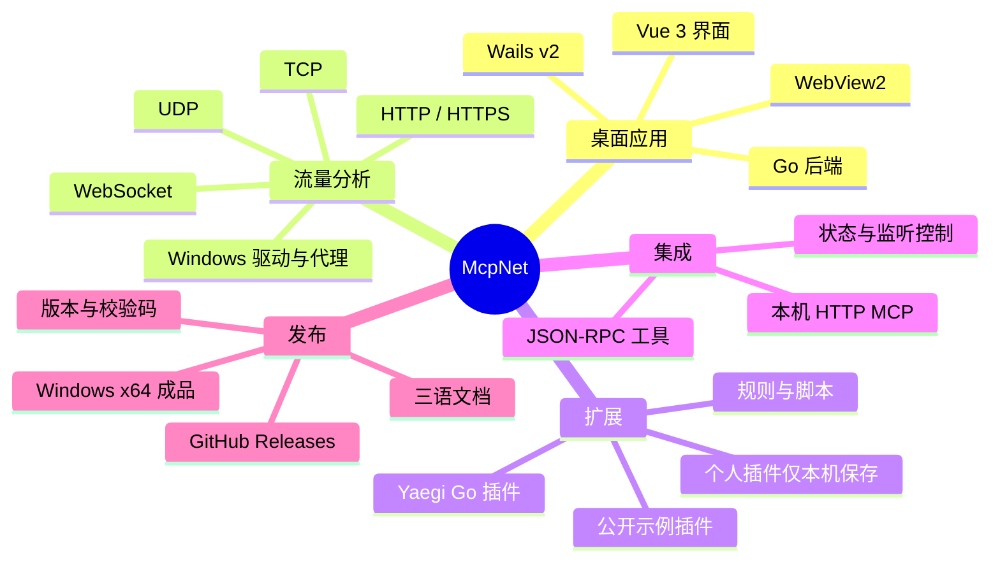
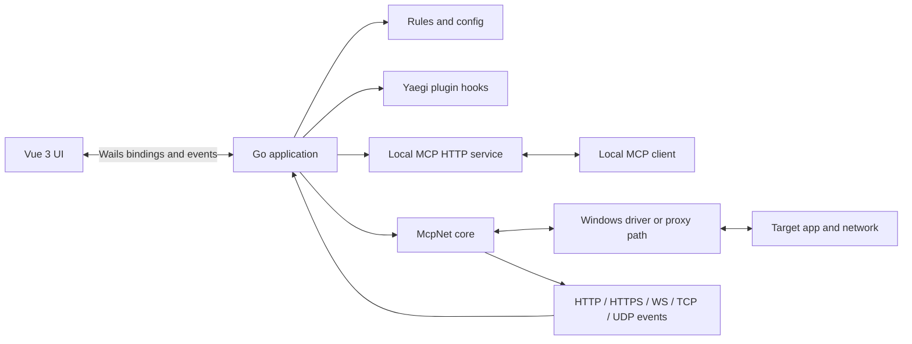
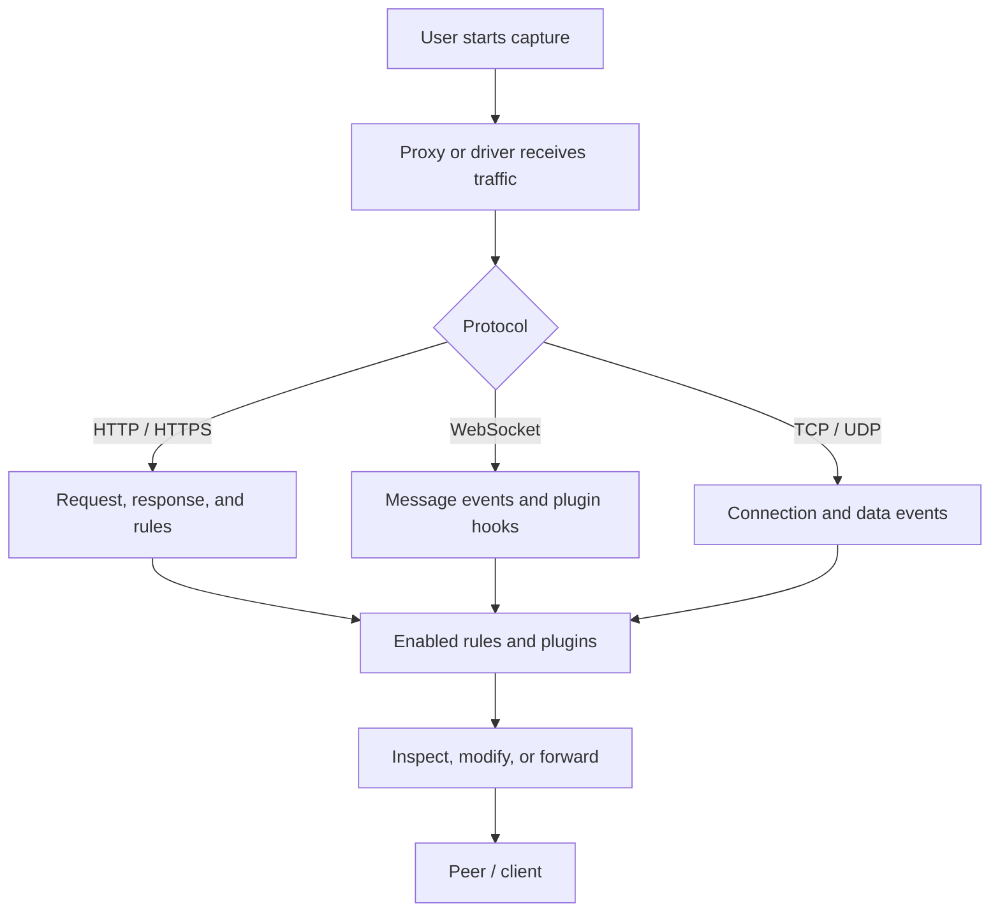
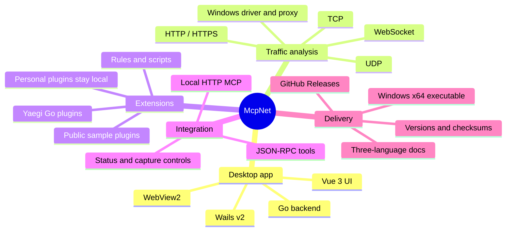

# McpNet

<p align="center"></p>

> Windows 桌面網路分析與協定除錯工具，整合封包檢視、規則處理、插件擴充與本機 MCP 服務。

**繁體中文（預設）** · [简体中文](#简体中文) · [English](#english)

| 最新穩定版 | 平台 | 直接下載 | 全部版本 |
|---|---|---|---|
| **v1.2.1** · MCP 工具擴充、操作確認與隱私保護 | Windows x64 | [下載 McpNet-v1.2.1-windows-x64.exe](https://github.com/infycat/McpNet/releases/download/v1.2.1/McpNet-v1.2.1-windows-x64.exe) | [全部版本](https://github.com/infycat/McpNet/releases) |

[v1.2.1 更新內容與 SHA-256](https://github.com/infycat/McpNet/releases/tag/v1.2.1)

下載成品請使用上表的 EXE 連結；GitHub 頁面上的 **Source code ZIP/TAR.GZ 是原始碼，不是安裝程式**。首次使用前請查看下方的系統需求及安全提醒。

## 專案簡介

McpNet 是以開源與可擴充為核心的 Windows 網路分析工具，由 Go/Wails 桌面後端、Vue 3 介面與 McpNet 網路核心組成。除了 HTTP(S)、WebSocket、TCP、UDP 流量分析、規則和本機 MCP，使用者也能透過 Go 插件自行打造協定解碼、封包條件、資料修改和小型工具介面，不必等待核心內建每一項功能。程式啟動不會自動開始全系統攔截：流量監聽與系統代理由使用者分別控制。

### 品牌圖示

新版採用方形透明底圖示，將「Net」字樣直接融入封包路徑與 MCP 連接節點；青綠漸層為主色，搭配白色連接點、黃色訊號段與深色描邊，讓網路抓包與 MCP 元素更清晰易辨。`build/appicon.png` 是預覽來源，Windows/Wails 使用的 `.ico` 資源同步更新為同一設計。

| 類別 | 功能 |
|---|---|
| 流量分析 | HTTP/HTTPS 請求與回應、WebSocket 訊息、TCP/UDP 連線與資料檢視 |
| 規則與處理 | Hosts、轉送／替換、請求與回應處理、憑證及腳本設定 |
| 開源插件平台 | 社群 ZIP／資料夾匯入、Go hook 自訂判斷與封包處理、HTML/JavaScript 插件小視窗 |
| MCP 整合 | 本機 HTTP MCP、狀態查詢、監聽控制、系統代理及 UI 命令工具 |
| 桌面介面 | Windows、Wails v2、Vue 3、WebView2；繁體中文、簡體中文與英文 |

## 架構與資料流程



### 封包處理流程



### 功能截圖

以下產品截圖用來直觀展示主要功能：進程攔截與附近應用清單、程式設定、多色系主題、本機 Go 插件編輯，以及 MCP 服務設定。

**進程攔截與附近應用清單**


**程式設定與語言選擇**


**多色系主題**


**本機 Go 插件編輯器**


**本機 MCP 服務設定**


### 開源插件生態：自己動手擴充功能

McpNet 不把功能限制在內建解碼器：核心、介面和插件範例以開源方式提供，讓使用者與社群作者能自行開發、分享插件，按自己的協定和工作流程組裝工具。這種開放式插件模式讓社群可以持續補充功能，而不必為每種封包格式等待主程式改版。

- **快速分享：** 插件可由 ZIP 或資料夾一鍵匯入，套件包含 `main.go` 和一個 JSON 清單；匯入後預設停用，避免來源不明的程式碼直接執行。
- **自由判斷：** Go hook 可依協定、方向、URL、字串、正則、位元組模式或任意自訂條件檢查 HTTP 請求／回應、WebSocket、UDP 等資料。
- **按需處理：** 插件可解碼或編碼資料、修改符合條件的封包，再交回既有流程轉送；使用者以 Go 邏輯定義觸發條件和處理方式。
- **自訂介面：** 清單可選擇提供 HTML/JavaScript 小視窗，透過插件 action 與 Go 邏輯交換參數和結果，製作專屬操作面板。
- **安全與邊界：** Go 插件在本機執行，沒有安全沙箱隔離，只匯入可信來源；個人插件、密鑰和抓包資料留在本機，倉庫只放通用公開範例。

詳細套件格式、hook 範例與 UI API 請參閱 [`plugins/examples/README.md`](plugins/examples/README.md)。

### 腦圖



### 專案分佈與發布



## 支援協定與 MCP

| 協定／介面 | 支援功能 | 條件與限制 |
|---|---|---|
| HTTP | 請求／回應檢視、規則處理、插件 hook、內容編輯 | 流量須經過已啟用的監聽路徑 |
| HTTPS / TLS | TLS/HTTPS 處理、憑證管理 | 解密取決於 CA 信任、憑證釘選及應用程式行為 |
| WebSocket | 連線與訊息檢視、訊息 hook、編解碼處理 | 取決於代理路徑及啟用的規則／插件 |
| TCP | 連線與資料事件、轉送及腳本處理 | 取決於 Windows 驅動或代理設定 |
| UDP | 收送事件與插件 hook | 擷取可能需要驅動、程序設定或代理 |
| MCP | JSON-RPC、工具呼叫、SSE、健康檢查 | 預設僅綁定 `127.0.0.1:2026` |

MCP 端點：`http://127.0.0.1:2026/mcp`；健康檢查：`http://127.0.0.1:2026/health`。支援 `initialize`、`ping`、`tools/list`、`tools/call`，提供封包清單／詳情、插件清單／導入／啟用，以及狀態、監聽、代理、既有 WebSocket/TCP/UDP 連線發送和通用 UI 命令。AI 可透過 `mcpnet_import_plugin` 導入 `main.go` 與 JSON（ZIP 或分開提供），再以 `mcpnet_set_plugin_enabled` 啟用；Go 插件會在本機執行，因此啟用必須由使用者在確認對話框中批准。封包本文預設不回傳；即使 AI 傳入 `include_body=true`，仍會先彈出使用者同意視窗。發送封包、變更監聽／系統代理及通用 UI 命令也需逐次批准。URL 查詢值、使用者資訊與片段會遮蔽，每段本文最多 64 KiB。服務只綁定 `127.0.0.1`，但本機其他程式也可能連線；請只連接信任的 MCP 客戶端。`mcpnet_send_session_data` 只能透過已存在的 WebSocket/TCP/UDP 會話發送，HTTP 請求使用通用 UI 命令執行重發；不會建立任意新連線。

HTTP(S) 捕獲可使用 `mcpnet_replay_capture` 重播到原始目標，每次都會先要求你確認；WebSocket/TCP/UDP 則使用 `mcpnet_send_session_data` 經既有連線發送。

## 版本與下載

目前正式下載版本為 v1.2.1；v1.2.0 及更早版本保留為舊版。v1.2.1 擴充 MCP 工具，讓 AI 客戶端在使用者逐次確認後操作插件、封包發送／重播、監聽與系統代理；捕獲本文等隱私資料需明確同意才提供。v1.2.0 將插件擴充提升為產品核心方向：以開源方式提供插件開發與分享能力。每次啟動日誌位於 `%LOCALAPPDATA%\McpNet_new\logs\McpNet_startup_*.log`，最近 50 份會保留。GitHub 自動產生的原始碼壓縮檔不是可執行成品。

| 版本 | 日期 | 狀態 | 平台 | 成品下載 | 發布資訊 |
|---|---|---|---|---|---|
| **v1.2.1** | 2026-10-24 | MCP 工具擴充、操作確認與隱私遮蔽 | Windows x64 | [McpNet-v1.2.1-windows-x64.exe](https://github.com/infycat/McpNet/releases/download/v1.2.1/McpNet-v1.2.1-windows-x64.exe) | [更新說明與 SHA-256](https://github.com/infycat/McpNet/releases/tag/v1.2.1) |
| **v1.2.0** | 2026-10-23 | 大更新：開源插件平台、社群匯入、Go hook 與自訂插件 UI | Windows x64 | [McpNet-v1.2.0-windows-x64.exe](https://github.com/infycat/McpNet/releases/download/v1.2.0/McpNet-v1.2.0-windows-x64.exe) | [更新說明與 SHA-256](https://github.com/infycat/McpNet/releases/tag/v1.2.0) |
| **v1.1.4** | 2026-10-23 | 插件匯入、Go hook 封包處理、自訂 HTML/JavaScript 介面 | Windows x64 | [McpNet-v1.1.4-windows-x64.exe](https://github.com/infycat/McpNet/releases/download/v1.1.4/McpNet-v1.1.4-windows-x64.exe) | [更新說明與 SHA-256](https://github.com/infycat/McpNet/releases/tag/v1.1.4) |
| **v1.1.3** | 2026-10-23 | 完整修正已確認的 SunnyNet 舊匯入路徑啟動崩潰 | Windows x64 | [McpNet-v1.1.3-windows-x64.exe](https://github.com/infycat/McpNet/releases/download/v1.1.3/McpNet-v1.1.3-windows-x64.exe) | [更新說明與 SHA-256](https://github.com/infycat/McpNet/releases/tag/v1.1.3) |
| **v1.1.2** | 2026-10-23 | 啟動相容性修正；恢復穩定編輯器初始化並補強日誌 | Windows x64 | [McpNet-v1.1.2-windows-x64.exe](https://github.com/infycat/McpNet/releases/download/v1.1.2/McpNet-v1.1.2-windows-x64.exe) | [更新說明與 SHA-256](https://github.com/infycat/McpNet/releases/tag/v1.1.2) |
| **v1.1.1** | 2026-10-20 | 修補版；整理源碼入口、Discord 社群與作者頁圖片尺寸 | Windows x64 | [McpNet-v1.1.1-windows-x64.exe](https://github.com/infycat/McpNet/releases/download/v1.1.1/McpNet-v1.1.1-windows-x64.exe) | [更新說明與 SHA-256](https://github.com/infycat/McpNet/releases/tag/v1.1.1) |
| **v1.1.0** | 2026-10-20 | 第二版；調整全屏設定視窗上下邊界、補充功能截圖 | Windows x64 | [McpNet-v1.1.0-windows-x64.exe](https://github.com/infycat/McpNet/releases/download/v1.1.0/McpNet-v1.1.0-windows-x64.exe) | [更新說明與 SHA-256](https://github.com/infycat/McpNet/releases/tag/v1.1.0) |
| **v1.0.0** | 2026-10-20 | 首個正式版本；主題底板、全屏設定視窗、圖示與作者頁更新 | Windows x64 | [McpNet-v1.0.0-windows-x64.exe](https://github.com/infycat/McpNet/releases/download/v1.0.0/McpNet-v1.0.0-windows-x64.exe) | [更新說明與 SHA-256](https://github.com/infycat/McpNet/releases/tag/v1.0.0) |

v1.1.2 回復至已驗證可啟動的 v1.1.1 編輯器初始化順序，移除可能將重複啟動轉送至隱藏程序的行為，並把 30 秒逾時改為持續記錄進度。每次啟動會在 `%LOCALAPPDATA%\McpNet_new\logs\` 建立帶時間與 PID 的日誌，保留最近 50 份；若無法寫入則回退至使用者設定目錄或 `%TEMP%`。每次發布 GitHub Release 後，GitHub Actions 會自動建置 Windows x64 EXE、上傳成品並補上檔案大小與 SHA-256。v1.1.1 的源碼入口、Discord 社群與作者頁更新詳見其 Release。

v1.1.0 成品大小：91,961,856 bytes；SHA-256：`6939D6EB999FE8869E0C89B987FE22C5EBC01446874429746B8D03F57F2E93CD`。v1.0.0 SHA-256：`BFC3825775BCE65E29169A6DE613294BB3D5B987B12E7425EDD83FF1218C7630`。v1.1.2 的檔案資訊會在自動建置完成後顯示於 Release。

## 安裝與使用

- **平台：** Windows x64。需要 WebView2 Runtime；部分流量攔截情境也需要相應驅動、憑證或系統設定。
- **啟動：** 下載 EXE 後執行。若 Windows 顯示 UAC，請依自己的環境判斷是否授權。
- **監聽：** 開啟程式不等於開始全系統抓包；在介面中自行啟動監聽，並按需要分別設定系統代理。
- **HTTPS：** 解密可能需要安裝並信任本機 CA；憑證釘選等應用程式保護可能阻止解密。
- **資料位置：** 設定、WebView2 資料及插件位於 `%USERPROFILE%\McpNet_new\`。
- **啟動診斷：** 若視窗未出現，請提供 `%LOCALAPPDATA%\McpNet_new\logs\` 中最新的 `McpNet_startup_*.log`；若該位置不可寫，程式會回退至使用者設定目錄，再使用 `%TEMP%\McpNet_new\logs\`。

只在你有權分析的裝置及流量上使用本工具。修改系統代理或安裝 CA 會影響本機網路行為，使用前請理解其影響。

## 插件與公開內容邊界

執行時從 `%USERPROFILE%\McpNet_new\plugins\<plugin-id>\` 載入使用者插件。在「程序設定 → 插件功能 → 導入插件」可選擇 ZIP 或資料夾；套件須在同一層包含 `main.go` 和一個 JSON 清單（建議命名 `plugin.json`）。檔案選擇由內置 WebView 處理，取消或匯入錯誤不會關閉主程式；匯入後預設停用，重複 ID 不會覆蓋既有插件。Go hooks 可自由組合協議、URL、字串、正則與位元組模式判斷，並可修改回應後繼續轉送。插件程式可在 Go hook 中呼叫 `mcpnet.OpenWindow(title, html)` 建立內置工具窗口，或 `mcpnet.OpenExternalURL(url)` 開啟外部 HTTP(S) 頁面；內置窗口透過 `parent.postMessage` 觸發 `OnPluginAction`，由 `mcpnet.Action()` 與 `mcpnet.Payload()` 讀取動作和 JSON 字串，並可用 `mcpnet.SetUIResult()` 回傳結果。客戶端只提供通用窗口容器，不會為每個插件硬加「開啟介面」按鈕。窗口在限制網路和頂層導覽的 sandbox iframe 執行（HTML 上限 256 KiB、payload/result 各上限 16 KiB）；Go 插件仍在本機執行且不是安全沙箱，只導入並啟用可信程式碼。

你的個人協定插件留在本機使用者資料目錄；GitHub 僅公開通用範例 `plugins/examples/`，不包含個人插件、協定金鑰、使用者設定、抓包資料或建置後的 EXE。公開版使用者不會取得本機個人插件。

## 從原始碼建置

需求：Windows、Go 1.23+、Node.js/npm、WebView2 Runtime。重新產生 Windows 資源時另需 MinGW `windres`。前端 `dist/` 與 `app.syso` 是 Go 建置輸入，請保留。

```powershell
npm --prefix frontend ci
npm --prefix frontend run build
powershell -ExecutionPolicy Bypass -File .\scripts\build.ps1
```

建置成品 `McpNet.exe` 不加入 Git；個人插件也由 `.gitignore` 排除。倉庫根目錄是本專案的 `deliverable/source/`，請勿改用上層工作區目錄作為發布根目錄。

## 目錄導覽

```text
.
├─ main.go, app.go, mcp.go, Config.go     Go / Wails 應用程式
├─ CommAnd/                               UI 命令與事件分派
├─ MapHash/                               請求／連線輔助
├─ Resource/                              內嵌腳本範本與資源
├─ frontend/src/                          Vue 前端原始碼
├─ frontend/dist/                         Go embed 使用的前端成品
├─ third_party/recovered-McpNet/          go.mod 本機 replace 核心
├─ build/                                 Windows 圖示與資源
├─ scripts/                               建置與維護腳本
├─ docs/                                  延伸技術文件
└─ plugins/examples/                      可公開的安全範例
```

## 授權與第三方元件

本專案採 MIT License。核心與前端包含第三方元件，仍適用其各自授權與版權聲明；發布或再散佈時請保留倉庫中的授權文件。

---

## 简体中文

[繁體中文](#mcpnet) · **简体中文（默认）** · [English](#english)

| 最新稳定版 | 平台 | 直接下载 | 全部版本 |
|---|---|---|---|
| **v1.2.1** · MCP 工具扩展、操作确认与隐私保护 | Windows x64 | [下载 McpNet-v1.2.1-windows-x64.exe](https://github.com/infycat/McpNet/releases/download/v1.2.1/McpNet-v1.2.1-windows-x64.exe) | [全部版本](https://github.com/infycat/McpNet/releases) |

[v1.2.1 更新内容与 SHA-256](https://github.com/infycat/McpNet/releases/tag/v1.2.1)

McpNet 是以开源和可扩展为核心的 Windows 网络分析工具，由 Go/Wails 后端、Vue 3 界面和 McpNet 核心组成。除 HTTP(S)、WebSocket、TCP、UDP 流量分析、规则和本机 MCP 外，用户还可通过 Go 插件自行打造协议解码、封包条件、数据修改和小型工具界面，不必等待核心内置每项功能。启动应用不会自动开启全系统流量拦截；监听与系统代理由用户分别控制。

### 品牌图标

新版采用方形透明底图标，将“Net”字样直接融入数据包路径与 MCP 连接节点；以青绿渐变为主色，搭配白色连接点、黄色信号段和深色描边，让网络抓包与 MCP 元素更清晰易辨。`build/appicon.png` 是预览源图，Windows/Wails 使用的 `.ico` 资源同步更新为同一设计。

| 类别 | 功能 |
|---|---|
| 流量分析 | HTTP/HTTPS 请求与响应、WebSocket 消息、TCP/UDP 连接与数据 |
| 规则处理 | Hosts、转发／替换、请求和响应处理、证书及脚本设置 |
| 开源插件平台 | 社区 ZIP／文件夹导入、Go hook 自定义判断与封包处理、HTML/JavaScript 插件小窗口 |
| MCP | 本机 HTTP MCP、状态查询、监听控制、系统代理及 UI 命令 |
| 桌面端 | Windows、Wails v2、Vue 3、WebView2；繁中、简中和英文 |

### 架构与流程





### 功能截图

以下产品截图直观展示主要功能：进程拦截与附近应用列表、程序设置、多色系主题、本地 Go 插件编辑和 MCP 服务设置。

**进程拦截与附近应用列表**


**程序设置与语言选择**


**多色系主题**


**本地 Go 插件编辑器**


**本机 MCP 服务设置**


### 开源插件生态：自己动手扩展功能

McpNet 不把功能局限于内置解码器：核心、界面和插件示例以开源方式提供，让用户与社区作者自行开发、分享插件，按自己的协议和工作流程组合工具。开放式插件模式让社区持续补充能力，不必为每种封包格式等待主程序更新。

- **快速分享：** 插件可从 ZIP 或文件夹一键导入，套件包含 `main.go` 和一个 JSON 清单；导入后默认停用，避免来源不明的代码直接运行。
- **自由判断：** Go hook 可按协议、方向、URL、字符串、正则、字节模式或任意自定义条件，检查 HTTP 请求／响应、WebSocket、UDP 等数据。
- **按需处理：** 插件可解码或编码数据、修改符合条件的封包，再交回现有流程转发；用户用 Go 逻辑定义触发条件和处理方式。
- **自定义界面：** 清单可选提供 HTML/JavaScript 小窗口，通过插件 action 与 Go 逻辑交换参数和结果，制作专属操作面板。
- **安全与边界：** Go 插件在本机运行，没有安全沙箱隔离，只导入可信来源；个人插件、密钥和抓包数据保留在本机，仓库仅放通用公开示例。

详细套件格式、hook 示例与 UI API 请参阅 [`plugins/examples/README.md`](plugins/examples/README.md)。

### 思维导图



### 协议与使用条件

| 协议／接口 | 能力 | 条件与限制 |
|---|---|---|
| HTTP | 请求／响应查看、规则、插件 hook、内容编辑 | 流量须通过已启用的监听路径 |
| HTTPS / TLS | TLS/HTTPS 处理、证书管理 | 解密受 CA 信任、证书固定及应用行为影响 |
| WebSocket | 连接与消息查看、消息 hook、编解码处理 | 取决于代理路径及已启用规则／插件 |
| TCP | 连接与数据事件、转发和脚本处理 | 取决于 Windows 驱动或代理设置 |
| UDP | 收发事件和插件 hook | 捕获可能需要驱动、进程配置或代理 |
| MCP | JSON-RPC、工具调用、SSE、健康检查 | 默认仅绑定 `127.0.0.1:2026` |

MCP 地址为 `http://127.0.0.1:2026/mcp`，健康检查为 `/health`。工具可查看捕获元数据、管理插件、操作界面命令，并通过现有 WebSocket/TCP/UDP 会话发送数据。AI 可用 `mcpnet_import_plugin` 导入 `main.go` 与 JSON（ZIP 或分开提供），再调用 `mcpnet_set_plugin_enabled`；插件会在本机运行，启用必须由用户在确认框批准。请求头和数据体默认不返回；即使传入 `include_body=true`，也会先询问用户。发送数据、改变监听／系统代理和通用 UI 命令逐次要求用户确认。URL 查询值、用户信息和片段会遮蔽，每段数据体最多 64 KiB。服务只绑定 `127.0.0.1`，本机其他程序仍可连接；仅连接可信 MCP 客户端。`mcpnet_send_session_data` 使用已有 WebSocket/TCP/UDP 会话；HTTP 重发通过通用 UI 命令，不会新建任意连接。

HTTP(S) 捕获可用 `mcpnet_replay_capture` 重发到原始目标，每次都会先询问用户；WebSocket/TCP/UDP 则通过 `mcpnet_send_session_data` 使用现有连接发送。

### 版本与下载

| 版本 | 日期 | 状态 | 平台 | 成品下载 | 发布信息 |
|---|---|---|---|---|---|
| **v1.2.1** | 2026-10-24 | MCP 工具扩展、操作确认与隐私遮蔽 | Windows x64 | [下载 EXE](https://github.com/infycat/McpNet/releases/download/v1.2.1/McpNet-v1.2.1-windows-x64.exe) | [更新说明与校验码](https://github.com/infycat/McpNet/releases/tag/v1.2.1) |
| **v1.2.0** | 2026-10-23 | 大更新：开源插件平台、社区导入、Go hook 与自定义插件 UI | Windows x64 | [下载 EXE](https://github.com/infycat/McpNet/releases/download/v1.2.0/McpNet-v1.2.0-windows-x64.exe) | [更新说明与校验码](https://github.com/infycat/McpNet/releases/tag/v1.2.0) |
| **v1.1.4** | 2026-10-23 | 插件导入、Go hook 封包处理、自定义 HTML/JavaScript 界面 | Windows x64 | [下载 EXE](https://github.com/infycat/McpNet/releases/download/v1.1.4/McpNet-v1.1.4-windows-x64.exe) | [更新说明与校验码](https://github.com/infycat/McpNet/releases/tag/v1.1.4) |
| **v1.1.3** | 2026-10-23 | 完整修复已确认的 SunnyNet 旧导入路径启动崩溃 | Windows x64 | [下载 EXE](https://github.com/infycat/McpNet/releases/download/v1.1.3/McpNet-v1.1.3-windows-x64.exe) | [更新说明与校验码](https://github.com/infycat/McpNet/releases/tag/v1.1.3) |
| **v1.1.2** | 2026-10-23 | 启动修复；延后加载编辑器并修正超时误报 | Windows x64 | [下载 EXE](https://github.com/infycat/McpNet/releases/download/v1.1.2/McpNet-v1.1.2-windows-x64.exe) | [更新说明与校验码](https://github.com/infycat/McpNet/releases/tag/v1.1.2) |
| **v1.1.1** | 2026-10-20 | 修补版；整理源码入口、Discord 社群与作者页图片尺寸 | Windows x64 | [下载 EXE](https://github.com/infycat/McpNet/releases/download/v1.1.1/McpNet-v1.1.1-windows-x64.exe) | [更新说明与校验码](https://github.com/infycat/McpNet/releases/tag/v1.1.1) |
| **v1.1.0** | 2026-10-20 | 第二版；调整全屏设置窗口边界、补充功能截图 | Windows x64 | [下载 EXE](https://github.com/infycat/McpNet/releases/download/v1.1.0/McpNet-v1.1.0-windows-x64.exe) | [更新说明与校验码](https://github.com/infycat/McpNet/releases/tag/v1.1.0) |
| **v1.0.0** | 2026-10-20 | 首个正式版本；修复主题底板与全屏设置窗口、更新图标与作者页 | Windows x64 | [下载 EXE](https://github.com/infycat/McpNet/releases/download/v1.0.0/McpNet-v1.0.0-windows-x64.exe) | [更新说明与校验码](https://github.com/infycat/McpNet/releases/tag/v1.0.0) |

当前正式下载版本为 v1.2.1，v1.2.0 及更早版本保留为历史版本。v1.2.1 扩展 MCP 工具，让 AI 客户端在用户逐次确认后操作插件、发送／重播数据包、控制监听与系统代理；捕获正文等隐私数据需明确同意才提供。v1.2.0 是插件功能的大更新：以开源为核心，让用户和社区自行开发、分享插件，扩展协议识别、灵活条件判断、封包处理及自定义 UI。插件默认停用；Go 代码仍在本机运行，请只启用可信来源。每次启动会在 `%LOCALAPPDATA%\McpNet_new\logs\` 写入带时间和 PID 的诊断日志，保留最近 50 份；无法写入时回退到用户配置目录或 `%TEMP%`。每次发布 GitHub Release 后，GitHub Actions 会自动构建 Windows x64 EXE、上传成品并补充文件大小与 SHA-256。GitHub 自动生成的 Source code 压缩包是源码，不是应用程序。

v1.1.0 文件大小：91,961,856 bytes；SHA-256：`6939D6EB999FE8869E0C89B987FE22C5EBC01446874429746B8D03F57F2E93CD`。v1.0.0 SHA-256：`BFC3825775BCE65E29169A6DE613294BB3D5B987B12E7425EDD83FF1218C7630`。

### 安装、插件与安全

- Windows x64；需要 WebView2 Runtime，部分捕获场景也需要驱动、证书或系统设置。
- 启动应用不会自动开启全系统抓包；请在界面中自行启动监听，并按需单独设置系统代理。
- HTTPS 解密可能需要安装并信任本机 CA；证书固定等机制可能阻止解密。仅分析你有权检查的设备与流量。
- 配置、WebView2 数据和用户插件位于 `%USERPROFILE%\McpNet_new\`。在“程序设置 → 插件功能 → 导入插件”可选择 ZIP 或文件夹；同一层需包含 `main.go` 和一个 JSON 清单（推荐 `plugin.json`）。文件选择由内置 WebView 处理，取消或导入错误不会关闭主程序。导入后默认停用，重复 ID 不覆盖。Go hooks 可自由组合协议、URL、字符串、正则或字节模式判断，并可改写响应后继续转发。插件 Go hook 可调用 `mcpnet.OpenWindow(title, html)` 建立内置工具窗口，或 `mcpnet.OpenExternalURL(url)` 打开外部 HTTP(S) 页面；窗口通过 `parent.postMessage` 触发 `OnPluginAction`，由 `mcpnet.Action()` 和 `mcpnet.Payload()` 读取动作和 JSON 字符串，并用 `mcpnet.SetUIResult()` 返回结果。客户端只提供通用窗口容器，不再为插件硬加专用“打开界面”按钮。内置窗口运行在限制网络和顶层导航的 sandbox iframe 中（HTML 上限 256 KiB、payload/result 各上限 16 KiB）；Go 插件代码本身仍在本机运行且不是安全沙箱，只导入并启用可信代码。
- 如果启动后没有出现窗口，请提供 `%LOCALAPPDATA%\McpNet_new\logs\` 中最新的 `McpNet_startup_*.log`；该目录不可写时会回退到用户配置目录，最后使用 `%TEMP%\McpNet_new\logs\`。
- 个人协议插件只保留在本机；GitHub 仓库仅包含 `plugins/examples/` 的通用示例，不发布个人插件、密钥、抓包或 EXE。

### 源码构建与目录

需要 Windows、Go 1.23+、Node.js/npm 和 WebView2 Runtime。`frontend/dist/` 与 `app.syso` 是构建输入。

```powershell
npm --prefix frontend ci
npm --prefix frontend run build
powershell -ExecutionPolicy Bypass -File .\scripts\build.ps1
```

主要目录：`CommAnd/`（UI 命令）、`MapHash/`（请求辅助）、`Resource/`（脚本资源）、`frontend/src/`（Vue 源码）、`frontend/dist/`（嵌入前端）、`third_party/recovered-McpNet/`（本地核心依赖）、`build/`（Windows 资源）、`scripts/`（构建脚本）、`docs/`（扩展文档）、`plugins/examples/`（公开示例）。此仓库以 `deliverable/source/` 为根目录。本项目采用 MIT License；第三方组件仍适用各自许可，重新发布时请保留其许可声明。

---

## English

[繁體中文](#mcpnet) · [简体中文](#简体中文) · **English (default)**

| Latest stable | Platform | Direct download | All versions |
|---|---|---|---|
| **v1.2.1** · Expanded MCP tools with consent and privacy safeguards | Windows x64 | [Download McpNet-v1.2.1-windows-x64.exe](https://github.com/infycat/McpNet/releases/download/v1.2.1/McpNet-v1.2.1-windows-x64.exe) | [All releases](https://github.com/infycat/McpNet/releases) |

[v1.2.1 notes and SHA-256](https://github.com/infycat/McpNet/releases/tag/v1.2.1)

McpNet is an open-source, extensible Windows network analysis tool built with a Go/Wails backend, Vue 3 UI, and the McpNet core. Alongside HTTP(S), WebSocket, TCP, and UDP analysis, rules, and local MCP, users can build Go plugins for protocol decoding, packet conditions, data modification, and small custom tools—without waiting for every capability to be built into the core. Launching the app does **not** enable system-wide interception; capture and system-proxy controls are separate.

### App icon

The refreshed square icon uses a transparent background and integrates the “Net” lettering with packet paths and MCP connection nodes. A cyan-to-mint gradient, white connector rings, yellow signal accents, and a dark outline make both network capture and MCP immediately recognizable. `build/appicon.png` is the preview source; the Windows/Wails `.ico` resources use the same artwork.

| Area | Capabilities |
|---|---|
| Traffic analysis | HTTP/HTTPS requests and responses, WebSocket messages, TCP/UDP connections and payloads |
| Rules | Hosts, forwarding/replacement, request/response processing, certificates, and scripts |
| Open plugin platform | Community ZIP/folder imports, flexible Go hooks and packet processing, custom HTML/JavaScript plugin windows |
| MCP | Local HTTP MCP, status, capture controls, system proxy, and UI-command tools |
| Desktop | Windows, Wails v2, Vue 3, WebView2; Traditional Chinese, Simplified Chinese, and English |

### Architecture and flow





### Feature screenshots

These product screenshots demonstrate the main features: process interception and nearby-process discovery, application settings, the multi-color theme gallery, local Go plugin editing, and MCP service configuration.

**Process interception and nearby-process list**


**Application settings and language selection**


**Multi-color themes**


**Local Go plugin editor**


**Local MCP service settings**


### Open plugin ecosystem: build your own features

McpNet is not limited to built-in decoders. Its core, UI, and plugin examples are open source so users and community authors can build and share plugins around their own protocols and workflows. This open extension model lets the community keep adding capabilities without waiting for every packet format to become a built-in feature.

- **Easy sharing:** Import a ZIP or folder containing `main.go` and one JSON manifest. Imported plugins are disabled by default so unfamiliar code never runs immediately.
- **Flexible matching:** Go hooks can inspect HTTP requests/responses, WebSocket, UDP, and other events using protocol, direction, URL, text, regexp, byte patterns, or arbitrary custom logic.
- **Custom processing:** Decode or encode data, modify matching packets, and return them to the existing forwarding flow. The plugin author defines when and how it runs.
- **Custom UI:** An optional HTML/JavaScript window can exchange inputs and results with Go plugin logic through plugin actions.
- **Safety and boundaries:** Go plugins run locally without a security sandbox; import trusted code only. Personal plugins, keys, and captures stay local; the repository publishes generic examples only.

See [`plugins/examples/README.md`](plugins/examples/README.md) for package format, hook examples, and the UI API.

### Mind map



### Protocols and conditions

| Protocol / interface | Capability | Conditions and limitations |
|---|---|---|
| HTTP | Request/response inspection, rules, hooks, body editing | Traffic must traverse an enabled capture path |
| HTTPS / TLS | TLS/HTTPS handling and certificate management | Decryption depends on CA trust, pinning, and app behavior |
| WebSocket | Connection/message inspection, hooks, codec processing | Depends on proxy path and enabled rules/plugins |
| TCP | Connection/data events, forwarding, and scripts | Depends on Windows driver or proxy configuration |
| UDP | Send/receive events and plugin hooks | Capture may require a driver, process setup, or proxy |
| MCP | JSON-RPC, tools, SSE, health check | Bound to `127.0.0.1:2026` by default |

MCP endpoints: `http://127.0.0.1:2026/mcp` and `/health`. Tools expose capture metadata/details, plugin listing/import/enabling, status, listener/proxy control, existing-session WebSocket/TCP/UDP sends, and a compatibility command for other UI features. AI can import `main.go` plus JSON (as a ZIP or separate fields) with `mcpnet_import_plugin`; enabling a plugin runs local Go code and requires direct user approval. Headers and bodies are omitted by default; even with `include_body=true`, a user confirmation dialog appears before private capture data is returned. Packet sends, listener/system-proxy changes, and generic UI commands also require per-action user approval. URL query values, user info, and fragments are redacted, and each body is capped at 64 KiB. The service binds only to `127.0.0.1`, but other local processes can connect, so connect trusted MCP clients only. `mcpnet_send_session_data` sends only through an existing WebSocket/TCP/UDP session; HTTP replay uses the generic UI command and no arbitrary new connection is created.

HTTP(S) captures can be replayed to their original destination with `mcpnet_replay_capture`, which always asks the user first. WebSocket/TCP/UDP payloads use `mcpnet_send_session_data` over an existing session.

### Versions and downloads

| Version | Date | Status | Platform | Download | Release info |
|---|---|---|---|---|---|
| **v1.2.1** | 2026-10-24 | Expanded MCP tools with per-action approval and privacy protections | Windows x64 | [Download EXE](https://github.com/infycat/McpNet/releases/download/v1.2.1/McpNet-v1.2.1-windows-x64.exe) | [Notes and checksum](https://github.com/infycat/McpNet/releases/tag/v1.2.1) |
| **v1.2.0** | 2026-10-23 | Major update: open plugin platform, community imports, Go hooks, and custom plugin UI | Windows x64 | [Download EXE](https://github.com/infycat/McpNet/releases/download/v1.2.0/McpNet-v1.2.0-windows-x64.exe) | [Notes and checksum](https://github.com/infycat/McpNet/releases/tag/v1.2.0) |
| **v1.1.4** | 2026-10-23 | Plugin imports, flexible Go hooks, and custom HTML/JavaScript UI | Windows x64 | [Download EXE](https://github.com/infycat/McpNet/releases/download/v1.1.4/McpNet-v1.1.4-windows-x64.exe) | [Notes and checksum](https://github.com/infycat/McpNet/releases/tag/v1.1.4) |
| **v1.1.3** | 2026-10-23 | Fully fixes confirmed startup crash from legacy SunnyNet imports | Windows x64 | [Download EXE](https://github.com/infycat/McpNet/releases/download/v1.1.3/McpNet-v1.1.3-windows-x64.exe) | [Notes and checksum](https://github.com/infycat/McpNet/releases/tag/v1.1.3) |
| **v1.1.2** | 2026-10-23 | Startup compatibility fix; restore editor initialization and improve diagnostics | Windows x64 | [Download EXE](https://github.com/infycat/McpNet/releases/download/v1.1.2/McpNet-v1.1.2-windows-x64.exe) | [Notes and checksum](https://github.com/infycat/McpNet/releases/tag/v1.1.2) |
| **v1.1.1** | 2026-10-20 | Patch; consolidated source links, Discord community, smaller author image | Windows x64 | [Download EXE](https://github.com/infycat/McpNet/releases/download/v1.1.1/McpNet-v1.1.1-windows-x64.exe) | [Notes and checksum](https://github.com/infycat/McpNet/releases/tag/v1.1.1) |
| **v1.1.0** | 2026-10-20 | Second release; maximized settings bounds fixed and feature screenshots added | Windows x64 | [Download EXE](https://github.com/infycat/McpNet/releases/download/v1.1.0/McpNet-v1.1.0-windows-x64.exe) | [Notes and checksum](https://github.com/infycat/McpNet/releases/tag/v1.1.0) |
| **v1.0.0** | 2026-10-20 | Initial stable release; themed panels, maximized settings, icon, and author page updated | Windows x64 | [Download EXE](https://github.com/infycat/McpNet/releases/download/v1.0.0/McpNet-v1.0.0-windows-x64.exe) | [Notes and checksum](https://github.com/infycat/McpNet/releases/tag/v1.0.0) |

The current official download is v1.2.1, with v1.2.0 and earlier releases retained as history. This update expands MCP tools for capture inspection, plugin workflows, packet sending/replay, and capture/proxy controls, with per-operation approval for sensitive actions. URL secrets are redacted by default; payloads and other private fields require explicit consent. Plugin code still runs locally, so enable trusted code only. Each launch writes a timestamped diagnostic log under `%LOCALAPPDATA%\McpNet_new\logs\` (with config-directory and `%TEMP%` fallbacks); the newest 50 are retained. Publishing a GitHub Release triggers GitHub Actions to build and upload the Windows x64 executable and add its file size and SHA-256. GitHub's automatically generated source archives are not executable builds.

v1.1.0 file size: 91,961,856 bytes; SHA-256: `6939D6EB999FE8869E0C89B987FE22C5EBC01446874429746B8D03F57F2E93CD`. v1.0.0 SHA-256: `BFC3825775BCE65E29169A6DE613294BB3D5B987B12E7425EDD83FF1218C7630`.

### Setup, plugins, and safety

- Windows x64; WebView2 Runtime is required. Release builds embed Microsoft's small Evergreen bootstrapper and can offer to install a missing runtime; the runtime download still requires internet. Some capture scenarios also need drivers, certificates, or OS configuration.
- Launching the app does not enable system-wide capture. Start capture in the UI and configure the system proxy separately as needed.
- HTTPS decryption may require trusting a local CA; certificate pinning may prevent decryption. Use only with devices and traffic you are authorized to inspect.
- User settings and plugins live under `%USERPROFILE%\McpNet_new\`; the WebView2 profile uses `%LOCALAPPDATA%\McpNet_new\WebView2` when available and falls back to other writable locations. In **Program Settings → Plugin Features → Import plugin**, select a ZIP or folder containing `main.go` and one JSON manifest (`plugin.json` recommended) at the same level. The embedded WebView handles selection so cancelling or an import error does not close the app. Imports are disabled by default and duplicate IDs are not overwritten. Go hooks can combine protocol, URL, string, regexp, and byte-pattern checks across HTTP request/response, WebSocket, UDP, and other events, then rewrite responses before forwarding. Go hook code can call `mcpnet.OpenWindow(title, html)` for an in-app tool window or `mcpnet.OpenExternalURL(url)` for an external HTTP(S) page. The generic client window hosts plugin HTML in a sandboxed iframe; `parent.postMessage` dispatches to `OnPluginAction`, with `mcpnet.Action()` and `mcpnet.Payload()` exposing the action and JSON string; `mcpnet.SetUIResult()` sends a result back. Network and top-level navigation are blocked (256 KiB HTML and 16 KiB payload/result limits). The client does not add a plugin-specific “Open UI” button. Go plugin code itself runs locally without a security sandbox; import and enable trusted code only.
- If the window does not appear at startup, provide the newest `McpNet_startup_*.log` from `%LOCALAPPDATA%\McpNet_new\logs\`. If that location is not writable, the app falls back to the user config directory and then `%TEMP%\McpNet_new\logs\`.
- Personal protocol plugins remain on the developer's machine. The GitHub repository contains only generic `plugins/examples/`; personal plugins, keys, captures, and the built EXE are not committed.

### Build from source and layout

Requirements: Windows, Go 1.23+, Node.js/npm, and WebView2 Runtime. `frontend/dist/` and `app.syso` are build inputs.

```powershell
npm --prefix frontend ci
npm --prefix frontend run build
powershell -ExecutionPolicy Bypass -File .\scripts\build.ps1
```

Key paths: `CommAnd/` (UI commands), `MapHash/` (request helpers), `Resource/` (script resources), `frontend/src/` (Vue source), `frontend/dist/` (embedded frontend), `third_party/recovered-McpNet/` (local core dependency), `build/` (Windows resources), `scripts/` (build scripts), `docs/` (extended docs), and `plugins/examples/` (public samples). The repository root is `deliverable/source/`. This project uses the MIT License; third-party components retain their own license terms, which must be preserved when redistributing.
