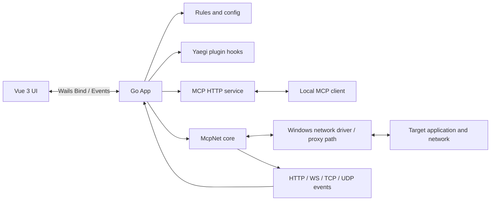
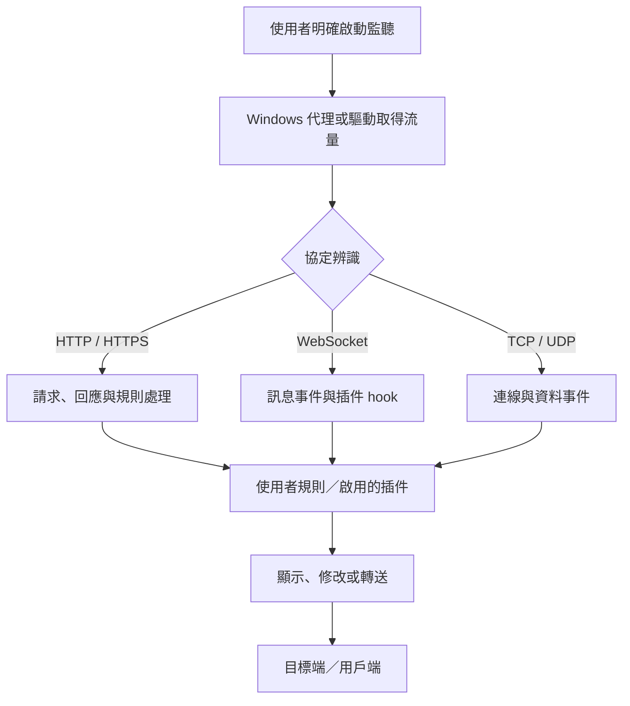
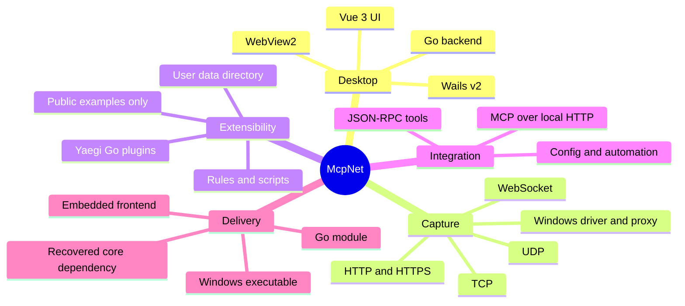
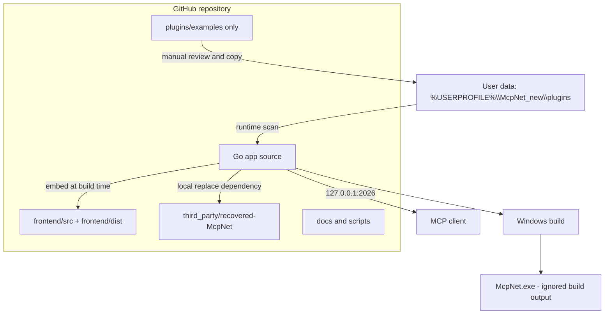
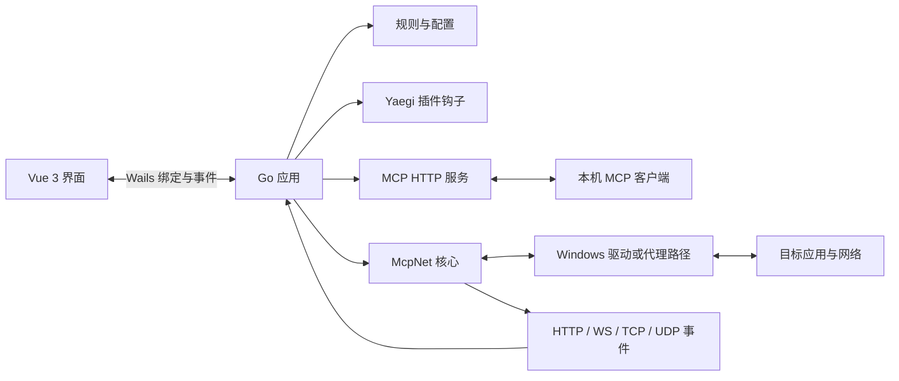
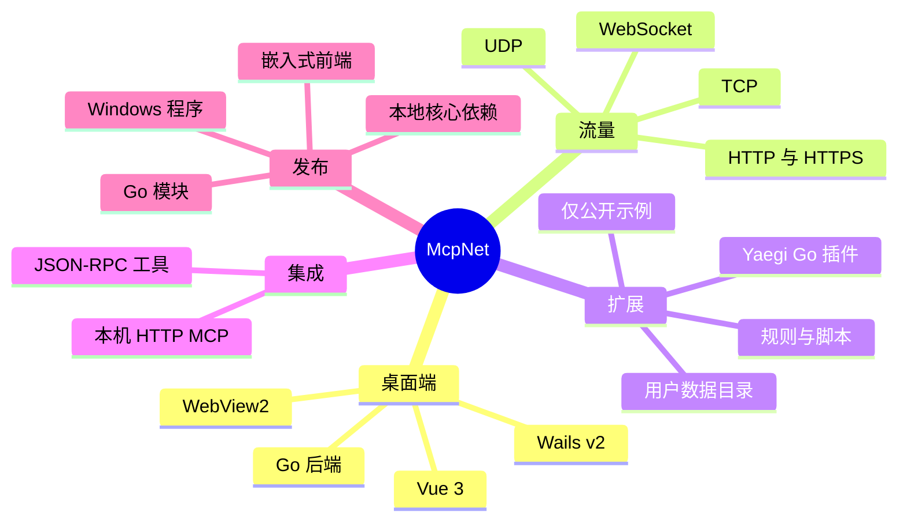
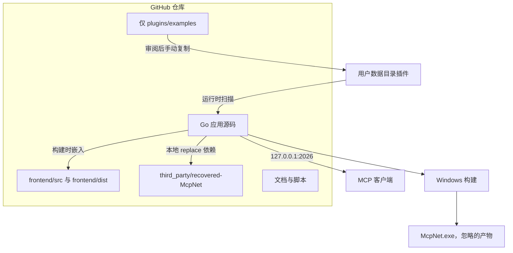
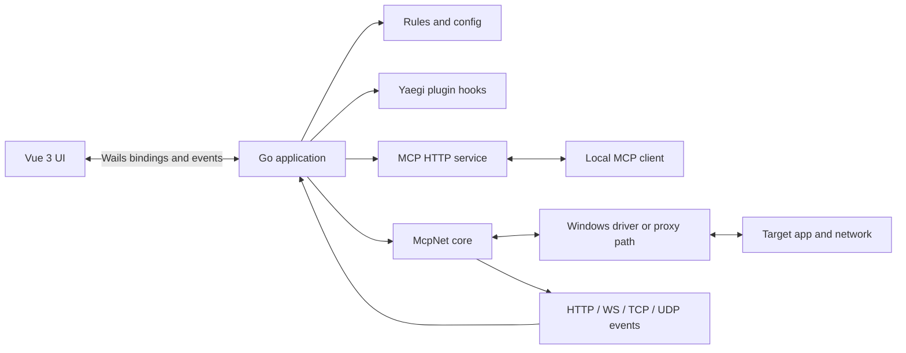
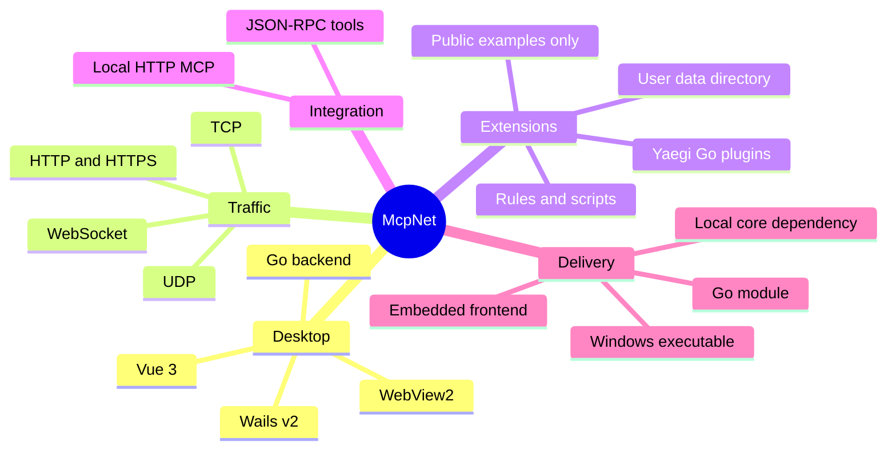
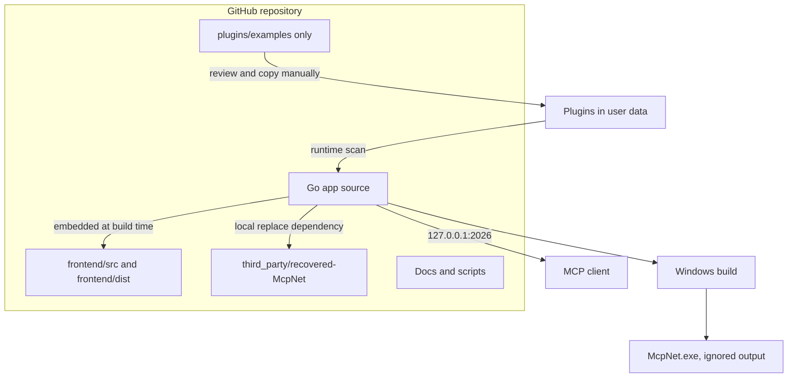

# 專案與架構指南

**繁體中文（預設）** · [简体中文](#简体中文) · [English](#english)

## 繁體中文

### 系統定位

McpNet 是 Windows 桌面網路分析工具。Vue 3 呈現介面；Wails v2 將前端命令和事件連到 Go 應用；Go 負責規則、插件、MCP 與使用者設定；本機重建的 McpNet 核心負責代理和協定處理。程式啟動會顯示 GUI 並啟動綁定 `127.0.0.1` 的 MCP 服務；流量監聽與系統代理則有各自的啟停控制。

### 元件與請求流程



典型資料流程：



### 腦圖



### 部署／分佈圖



### 路徑與責任

```text
repository root/
├─ main.go, app.go, mcp.go, Config.go, ...   Go app and Wails entry points
├─ CommAnd/                                  UI command/event dispatch
├─ MapHash/                                  request/session lookup helpers
├─ Resource/                                 embedded script templates and metadata
├─ frontend/
│  ├─ src/                                   Vue UI source
│  ├─ wailsjs/                               generated Wails bindings
│  └─ dist/                                  embedded production assets (build input)
├─ third_party/recovered-McpNet/             local core module from go.mod replace
├─ build/                                    Windows resources and application icons
├─ scripts/                                  Windows build and cleanup scripts
├─ docs/                                     architecture and reverse-engineering notes
└─ plugins/examples/                          safe, non-personal sample plugins only
```

Keep these module-relative paths stable: `main.go` embeds `frontend/dist`; `go.mod` replaces `github.com/qtgolang/McpNet` with `./third_party/recovered-McpNet`; build scripts locate the module root relative to `scripts/`. Moving any of these requires updating the embed directive, `replace`, and scripts together. User configuration and installed plugins belong under `%USERPROFILE%\McpNet_new\`, never in the repository.

### 品牌圖示與 Windows 資源

`build/appicon.png` 是目前品牌圖示的透明底預覽來源；Windows/Wails 使用的 `build/appicon.ico`、`build/appicon-focused.ico` 與 `build/windows/icon.ico` 由相同圖稿同步產生，`app.rc` 將 `build/appicon.ico` 編入 `app.syso`。新版把「Net」字樣、封包路徑與 MCP 連接節點整合，並以青綠漸層、白色連接點和黃色訊號段強化辨識。更新圖稿後需重新產生 Windows 資源並重新建置，既有 EXE 不會自動變更。

### 協定與支援功能

| 協定／介面 | 已實作能力 | 條件與備註 |
|---|---|---|
| HTTP | 請求／回應檢視、規則處理、插件 hook、內容編輯 | 必須經過已啟用的監聽路徑 |
| HTTPS / TLS | TLS/HTTPS 流量處理與憑證管理 | 解密依 CA 信任、應用程式憑證釘選及設定而異；不保證所有應用均可解密 |
| WebSocket | 連線／訊息檢視、訊息 hook、編解碼規則 | 插件可讀寫訊息本文；依連線是否經代理及規則而定 |
| TCP | 連線與資料事件、轉送／腳本處理 | 依 Windows 驅動或代理設定；不是背景自動全攔截 |
| UDP | 收送資料事件及插件 hook | Windows 擷取依驅動和程序設定；部分路徑需 SOCKS5 等代理 |
| MCP | `POST /mcp` JSON-RPC、`GET /mcp` SSE、`/health` | 預設 `127.0.0.1:2026`；可查詢捕獲會話和 WebSocket/TCP/UDP 訊息，也可控制監聽與系統代理 |

MCP 服務支援 `initialize`、`ping`、`tools/list`、`tools/call`，並回覆 `resources/list`、`prompts/list`（目前為空集合）。除捕獲與狀態工具外，也提供插件列舉／導入／啟用、既有 WebSocket/TCP/UDP 會話發送及通用 UI 命令。`include_body=true` 會觸發 Wails 使用者確認對話框；發送封包、啟停監聽、修改系統代理、導入／啟用插件及通用 UI 命令同樣逐次要求確認。封包清單預設只回傳中繼資料，URL 查詢值、使用者資訊和片段會遮蔽；本文 Base64 傳回且每段最多 64 KiB。捕獲工具只讀取介面已顯示的會話，不會自行啟動監聽。MCP 只綁定 loopback，但本機其他程式仍可能連線，故不可把 loopback 當成身份驗證；封包內容仍需視為敏感資料。

### 插件與公開邊界

- 倉庫只允許 `plugins/examples/` 下的公開範例；`.gitignore` 將其餘 `plugins/` 內容排除。
- 個人完成品插件（包含協定專用 XXTEA/XOR 插件）、金鑰、抓包與使用者設定不應提交。
- 執行時插件從 `%USERPROFILE%\McpNet_new\plugins\<id>\` 載入。可在「程序設定 → 插件功能 → 導入插件」選擇 ZIP 或資料夾；套件須在同一層包含 `main.go` 與一個 JSON 清單（建議 `plugin.json`），導入後預設停用，避免未審閱程式碼自動執行。重複 ID 不會覆蓋現有插件。
- 啟用插件會在流量事件中執行；程式碼由本機 Yaegi 執行，並非安全沙箱，可能讀取或修改流量，只導入及啟用可信任來源的插件。
- hook：`OnHTTPRequest`、`OnHTTPResponse`、`OnWebSocket`、`OnUDP`、`OnURLDisplay`。作者可直接在 Go hook 內組合協議、URL、字串、`regexp` 正則與位元組格式判斷；可用 API 包含 `Direction`、`Host`、`Path`、`URL`、`SetURL`、`Method`、`PID`、`Process`、`Body`、`SetBody`、`SetWireBody`、Hex/Base64、XOR/XXTEA 工具與 `Log`。`OnURLDisplay` 與 `SetURL` 僅修改 UI 顯示，不變更實際請求 URL。
- 插件可在任一 Go hook 中依自己的條件呼叫 `mcpnet.OpenWindow(title, html)` 開啟內置工具窗口，或 `mcpnet.OpenExternalURL(url)` 開啟外部 HTTP(S) 網址；客戶端只提供通用窗口容器，不會替每個插件加固定「開啟介面」按鈕。窗口透過 `parent.postMessage({type:"mcpnet-plugin-action",action:"run",payload:{...}},"*")` 觸發 `OnPluginAction`，由 `mcpnet.Action()`、`mcpnet.Payload()` 讀取動作及 JSON 字串，並可用 `mcpnet.SetUIResult()` 回傳文字結果。HTML/JavaScript 在限制網路和頂層導覽的 iframe sandbox 執行；HTML 上限 256 KiB，payload/result 各上限 16 KiB。Go 插件仍不是安全沙箱，必須審查並信任來源。
- `SetBody` 會標記資料已變更；不要假設只讀插件具有沙箱隔離。
- 個人協定插件（WebSocket XXTEA/XOR、URL 顯示解碼與 UDP 解碼）安裝於 `%USERPROFILE%\McpNet_new\plugins\personal-local-codecs\`，只存在本機，不隨 GitHub 源碼發布。

### 建置與品質檢查

前端先執行 `npm ci` 與 `npm run build`，再於模組根目錄執行 Go 建置或 `scripts/build.ps1`。建置產物 `McpNet.exe` 不納入 Git。`frontend/dist`、`app.syso` 是可重現建置所需的輸入資源，除非同步調整建置流程，否則勿忽略。第三方恢復核心的來源與限制請看 [third_party/recovered-McpNet/README.md](../third_party/recovered-McpNet/README.md)。

---

## 简体中文

### 系统定位与流程

McpNet 是 Windows 桌面网络分析工具，由 Vue 3 前端、Wails v2/Go 应用和本地重建的 McpNet 核心组成。应用启动会显示 GUI 并启动绑定 `127.0.0.1` 的 MCP 服务；流量监听与系统代理分别控制，启动应用不等于开始全系统抓包。







### 目录、协议与发布

主要目录：Go/Wails 文件位于仓库根目录；`CommAnd/` 为命令分发，`MapHash/` 为请求会话辅助，`Resource/` 为嵌入脚本模板；`frontend/src` 为 Vue 源码，`frontend/dist` 为 Go embed 构建输入；`third_party/recovered-McpNet` 是 `go.mod` 的本地 replace 核心；`build/` 放 Windows 图标和资源，当前透明方形图标将“Net”字样与数据包路径及 MCP 连接节点结合，PNG/ICO 资源保持一致；`scripts/` 放构建脚本，`docs/` 放项目文档，`plugins/examples/` 仅放公开示例。请勿随意移动 `frontend/dist`、第三方核心或 `scripts`，否则要同步更新 embed、replace 和脚本路径。

| 协议／接口 | 功能与限制 |
|---|---|
| HTTP | 查看请求／响应、规则处理、插件钩子与内容编辑；流量须经过已启用的监听路径。 |
| HTTPS/TLS | 支持 TLS/HTTPS 与证书管理；解密受 CA 信任、证书固定和应用设置影响。 |
| WebSocket | 查看连接与消息、运行消息钩子和编解码规则。 |
| TCP | 连接与数据事件、转发和脚本处理；取决于驱动或代理设置。 |
| UDP | 收发事件和插件钩子；Windows 捕获可能需要驱动、进程配置或代理。 |
| MCP | `POST /mcp` JSON-RPC、`GET /mcp` SSE、`/health`；默认只监听 `127.0.0.1:2026`。支持查询捕获会话和 WebSocket/TCP/UDP 消息，以及状态、监听和代理控制。 |

MCP 方法包括 `initialize`、`ping`、`tools/list`、`tools/call`；资源和提示列表目前为空。除捕获和状态工具外，还提供插件列举／导入／启用、已有 WebSocket/TCP/UDP 会话发送及通用 UI 命令。`include_body=true` 会触发 Wails 用户确认；发送数据、监听／代理更改、导入／启用插件和通用 UI 命令也逐次要求确认。默认仅返回元数据，URL 查询参数值、用户信息和片段会自动遮蔽；数据体以 Base64 返回且每段最多 64 KiB。查询不会自动开启监听。MCP 绑定回环地址不代表本机程序无法访问，因此捕获数据仍应视作敏感信息。

插件运行目录为 `%USERPROFILE%\McpNet_new\plugins\<id>\`。可在“程序设置 → 插件功能 → 导入插件”选择 ZIP 或文件夹；包内同一层必须有 `main.go` 和一个 JSON 清单（建议命名 `plugin.json`）。文件选择由内置 WebView 处理，取消或验证错误不会关闭主程序。导入的插件默认禁用，重复 ID 不覆盖现有插件。插件由本机 Yaegi 运行，并非安全沙箱；Go hook 可自由组合协议、URL、文本、正则及字节模式筛选，`SetBody`/`SetWireBody` 可改写数据后继续转送，`SetURL` 只修改界面显示。Go hook 可按需调用 `mcpnet.OpenWindow(title, html)` 创建内置工具窗口，或调用 `mcpnet.OpenExternalURL(url)` 打开外部 HTTP(S) 页面；客户端只提供通用容器，不增加固定的插件界面按钮。窗口消息通过 `parent.postMessage` 触发 `OnPluginAction`，并用 `mcpnet.Action()`/`mcpnet.Payload()` 读取动作和 JSON 数据；`mcpnet.SetUIResult()` 可回传结果。UI 在限制网络与顶层导航的 sandbox iframe 运行，HTML 上限 256 KiB、payload/result 各上限 16 KiB；Go 插件本身仍须视为可执行的本机代码。仅导入可信插件。GitHub 仓库仅允许 `plugins/examples/`，忽略个人插件、密钥、抓包和用户配置；示例默认禁用。个人 XXTEA/XOR、URL 显示及 UDP 解码插件保留在本机用户数据目录，不发布到 GitHub。

构建前在 `frontend/` 执行 `npm ci`、`npm run build`，再在 Go 模块根目录运行 `go build` 或 `scripts/build.ps1`。`McpNet.exe` 是忽略的构建产物；`frontend/dist` 和 `app.syso` 仍是构建输入。HTTPS 解密、驱动捕获和系统代理仅用于获得授权的设备与流量。

---

## English

### System overview and flow

McpNet is a Windows desktop network analysis tool built from a Vue 3 frontend, a Wails v2/Go application, and a locally reconstructed McpNet core. Startup opens the GUI and starts an MCP service bound to `127.0.0.1`; capture and system-proxy controls are separate. Launching the app does not itself enable system-wide interception.







### Repository layout and supported protocols

The repository root contains the Go/Wails app. `CommAnd/` dispatches UI commands; `MapHash/` contains request/session helpers; `Resource/` holds embedded script templates. `frontend/src` is the Vue source and `frontend/dist` is the Go embed input. `third_party/recovered-McpNet` is the local module selected by `go.mod`; `build/` contains Windows resources and the current transparent square icon, which integrates the “Net” lettering with packet paths and MCP connection nodes; `scripts/` contains build scripts, `docs/` contains project documentation, and `plugins/examples/` contains public sample plugins only. Keep the embed, local `replace`, and build-script paths in sync if any of these directories move.

| Protocol / interface | Implemented capability | Conditions |
|---|---|---|
| HTTP | Request/response inspection, rules, plugin hooks, and body editing | Traffic must traverse an enabled capture path. |
| HTTPS / TLS | TLS/HTTPS handling and certificate management | Decryption depends on CA trust, certificate pinning, and application behavior. |
| WebSocket | Connection/message inspection, message hooks, codec rules | Depends on the connection traversing the proxy and applicable rules. |
| TCP | Connection/data events, forwarding, and scripts | Depends on Windows driver or proxy configuration. |
| UDP | Send/receive events and plugin hooks | Windows capture may require a driver, process setup, or proxy. |
| MCP | JSON-RPC `POST /mcp`, SSE `GET /mcp`, and `/health`; query captured sessions and socket messages | Bound to `127.0.0.1:2026` by default. |

MCP methods include `initialize`, `ping`, `tools/list`, and `tools/call`; resource and prompt lists are currently empty. Tools expose capture inspection, plugin list/import/enable, sends through existing WebSocket/TCP/UDP sessions, status, listener/proxy control, generic UI commands, and help. `include_body=true` prompts the user through a native confirmation dialog before any private capture content is returned. Packet sends, listener/proxy changes, plugin imports/enabling, and generic UI commands also require per-action confirmation. Capture listings return metadata only; URL query values, user info, and fragments are redacted. Payloads are Base64 and capped at 64 KiB each. Querying does not start capture. Loopback binding does not prevent other local processes from connecting, so only trusted MCP clients should be configured and captured traffic remains sensitive.

Runtime plugins are loaded from `%USERPROFILE%\McpNet_new\plugins\<id>\`. Use **Program Settings → Plugin Features → Import plugin** to select a ZIP or folder containing `main.go` and exactly one JSON manifest (`plugin.json` recommended) at the same level. The embedded WebView handles selection; cancellation or validation errors do not close the app. Imports are disabled by default and duplicate IDs are never overwritten. Plugins run locally in Yaegi without a security sandbox; Go hooks can combine protocol, URL, text, regexp, and byte-pattern checks across HTTP request/response, WebSocket, UDP, and other events, then rewrite response bodies before forwarding. `SetURL` changes display only. A Go hook can call `mcpnet.OpenWindow(title, html)` to open a plugin-owned in-app tool window or `mcpnet.OpenExternalURL(url)` to open an external HTTP(S) page; the client provides a generic host rather than a fixed per-plugin UI button. Window messages use `parent.postMessage({type:"mcpnet-plugin-action",action:"run",payload:{...}},"*")` and dispatch to `OnPluginAction`, where `mcpnet.Action()` and `mcpnet.Payload()` expose the action and JSON payload string; `mcpnet.SetUIResult()` returns a text result to the page. UI HTML is limited to 256 KiB and each action payload/result to 16 KiB. Native Go plugin code remains unsandboxed; inspect code and trust its source before enabling. The GitHub allowlist keeps only `plugins/examples/`; personal finished plugins, keys, captures, and user configuration must not be committed. Personal WebSocket XXTEA/XOR, URL display, and UDP decoding stay under the local user-data directory. The example is disabled by default.

Build the frontend with `npm ci` and `npm run build` in `frontend/`, then run `go build` from the module root or use `scripts/build.ps1`. `McpNet.exe` is ignored build output; `frontend/dist` and `app.syso` remain build inputs. Use HTTPS decryption, driver capture, and system proxy features only on devices and traffic you are authorized to inspect.
